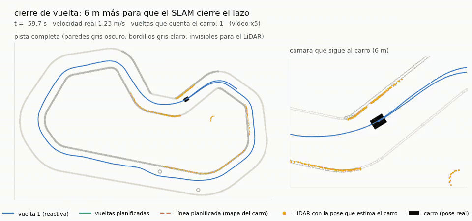

# Deep Drive APEX

ROS 2 autonomy for an RC car: learned LiDAR–inertial odometry, `slam_toolbox`,
reactive reconnaissance, map-guided planning and online plant identification.
Gazebo and the physical vehicle use the same driving core. Their ROS workspaces
are built separately.

## Approved physical implementation

On October 24, 2026, the operator selected **run `20261024_005311`** after
confirming successful two-lap operation at the desired original-like speed.
The exact acquisition runtime is tagged
[`real-car-approved-20261024-005311`](https://github.com/Santiago23florido/Deep-Drive-APEX/tree/real-car-approved-20261024-005311).
Subsequent documentation and simulator tests do not change that snapshot.


| Development run | Reconnaissance lap | Second lap | Reverse starts, lap 1 / 2 |
| --- | ---: | ---: | ---: |
| Original reference `20261023_222959` | 34.209 s | 14.844 s | 5 / 1 |
| Earlier full capture `20261024_000432` | 83.823 s | 42.773 s | 13 / 4 |
| **Approved `20261024_005311`** | **46.837 s** | **14.594 s** | **8 / 1** |

The second lap executed **MAP_GUIDED** local planning using SLAM and the observed
route. The optimized global candidate was rejected by feasibility checks. One
reverse recovery remained on lap 2. The operator confirmed physical operation;
contact with boundaries was not reported. Maps and trajectories below are
onboard estimates, with no external motion ground truth.

### Data, timing and Raspberry Pi measurements

| Quantity, approved run | Recorded value | Interpretation |
| --- | ---: | --- |
| Raw IMU / LiDAR / receipt records | 9,002 / 889 / 9,891 | Schema, count, time and critical finite-field checks passed |
| Hybrid odometry processing, median / P95 / max | 14.165 / 18.128 / 26.490 ms | Includes preprocessing, ICP/network or stationary hold, deskew and integration |
| Scan stamp to estimate output, median / P95 | 149.165 / 164.091 ms | Includes acquisition and waiting; distinct from processing time |
| Propagated pose age at control, median / P95 | 15.000 / 23.240 ms | IMU propagation does not supply a new LiDAR correction |
| Maximum command publication gap | 45.05 ms | No recorded bridge timeout, stale-data stop or core-busy stop |
| Odometry / driver / recorder CPU, median | 31.49 / 96.97 / 11.00% of one core | Driver has little headroom on its assigned core |
| Container CPU, median | 195.95% of one core | About two cores; not 195.95% of the whole four-core host |
| Odometry RSS | 756.72 MiB | Resident memory, not total system memory |
| Stationary maximum estimated excursion | 1.866 mm over 9.696 s | Full pipeline with stationary hold, not model-only accuracy |
| Scan consistency mean | 0.03520 m | Correlated geometric diagnostic, not absolute position error |
| Forward command median / positive ESC snapshot median | 0.09 m/s / 17.97 ESC-percent | Commanded values; both match the original reference |
| LiDAR header intervals above 150 ms | 4 | Preserved in the data; no stale-data stop recorded |
| Live Pi power fault samples | 0 | Motor terminal voltage/current were not measured |

Trial output was written to RAM and persisted after stopping with SHA256 checks
and `fsync`. All **138 selected runtime files** matched PC/Pi before and after
the trial. The portable archive contains **305 verified payload files**, including
raw sensors, commands/PWM, maps, resources, exact source/configuration/model
snapshots, operator feedback and offline reproduction scripts.

- [Download the complete archive, 10,004,574 bytes](real_vehicle/docs/paper/20261024_005311/real_vehicle_20261024_005311.zip)
- [SHA256](real_vehicle/docs/paper/20261024_005311/real_vehicle_20261024_005311.zip.sha256): `cdcda4bf8d42be5b5ab841ccaa8c70922119a268e8fce094cbc143ffacaf2721`
- [Capture details and measurement definitions](real_vehicle/docs/paper/20261024_005311/README.md)
- [Metrics CSV](real_vehicle/docs/paper/20261024_005311/paper_metrics.csv), [LaTeX table](real_vehicle/docs/paper/20261024_005311/paper_timing_table.tex), [run comparison](real_vehicle/docs/paper/20261024_005311/run_comparison.csv)

### Figures for the paper

All six figures have English labels, vector PDF/SVG and 600 dpi PNG exports.
The ZIP includes the data and scripts used to reproduce them offline.

| SLAM map and estimated laps | Transition to map-guided control |
| --- | --- |
|  |  |
| **Odometry consistency and timing** | **Raspberry Pi resources** |
|  |  |

The [lap comparison](real_vehicle/docs/paper/20261024_005311/figures/single_run_lap_comparison.pdf)
completes the six-figure set. Scan consistency is a correlated pipeline
diagnostic, not absolute odometry error or ATE/RPE. These development repeats
used different online estimates, maps and unmeasured battery conditions; their
comparison does not establish a controlled ablation or a statistical success rate.

### Retained control correction

The Kalman identifier continues fitting longitudinal gain and offset, but control
uses them only when independent longitudinal confidence reaches **0.5** and the
existing sample-count/residual gates pass. Until then, effective gain/offset
remain **1/0**. This prevents an underdetermined fit after a few low-speed or
reverse observations from suppressing the forward command. Steering adaptation
and deadband/launch learning continue.

The approved run ended with raw confidence **0.421**, raw gain/offset
**0.6 / 0.0203**, and `longitudinal_applied=false`; effective values stayed 1/0.
No neural weights were retrained for this correction. Real and simulated driving
cores are checked for byte and semantic parity.

An opt-in [forward speed calibration experiment](real_vehicle/docs/calibration/speed_initialization_20261024/README.md)
normalizes the hardware speed-to-PWM map while retaining the control law and
approved pace. It adds explicit reference logging. Motor simulation passes;
full-track integration has documented failures. A [physical follow-up](real_vehicle/docs/calibration/speed_initialization_20261024/physical_trial_190956/README.md)
completed two laps but exposed weak PWM feedback and persistent speed error.
Further [initialized-profile trials](real_vehicle/docs/calibration/speed_initialization_20261024/feedback_correction/README.md)
failed at the first curve. After a renewed battery and a raised inner boundary,
[run `211216` using the approved profile](real_vehicle/docs/calibration/speed_initialization_20261024/physical_trial_211216/README.md)
completed two operator-confirmed laps without contact, in 43.842 / 33.922 s,
with 6 / 4 reverse starts. Its settled second-lap nominal reference was 0.150
against a 0.354 m/s onboard estimate; physical speed tracking remains unvalidated.
The approved profile remains the default. With a prepared,
stationary car on a clear track, `./real_vehicle/tools/pc/race_pi.sh --profile initialized run`
deploys the hash-checked payload and performs the bounded experimental trial.
This command moves the car. Preview it with `--dry-run` before `run`.

## From the PC: SSH preflight and recognition-to-SLAM run

The PC entry point is [`real_vehicle/tools/pc/race_pi.sh`](real_vehicle/tools/pc/race_pi.sh).
Run these commands from the repository root. It uses the `ensta` account,
noninteractive SSH and passwordless `sudo` on the prepared Pi. The deployed
runtime root is **`/home/ensta/AiAtonomousRc/APEX`**, containing `real_vehicle/`'s
contents; the estimator environment is separate at `/home/ensta/odom_rt`.

```bash
# Read the current state; no new trial.
./real_vehicle/tools/pc/race_pi.sh --host ensta@raspberrypi status

# Fresh pre-run: sensors, stationary odometry, SLAM, parameters, command gaps,
# recorder and power checks. Disarmed throughout, then shuts the stack down.
./real_vehicle/tools/pc/race_pi.sh --host ensta@raspberrypi preflight

# With the car at the start and the track clear: this command MOVES the car.
# Fresh recognition lap -> automatic SLAM/map-guided continuation -> stop.
./real_vehicle/tools/pc/race_pi.sh --host ensta@raspberrypi run
```

Use `--dry-run` to print either operation without connecting. The wrapper
refuses a new preflight/run if `apex_pipeline` already exists. It installs the
exact [recorded helper copies](real_vehicle/tools/core/validated_trial_20261024_000432/README.md)
at their original diagnostic path before delegating:

| PC mode | Pi script | Effect |
| --- | --- | --- |
| `preflight` | `data/diagnostics/20261022_open_segment/run_oval.py --diagnose-only` | Same onboard preflight; never publishes `arm=true`; captures diagnostics and stops |
| `run` | `sudo python3 tools/core/run_ram_capture.py --root /home/ensta/AiAtonomousRc/APEX --execute` | Approved two-lap capture on RAM, temporary 2.0 GHz CPU ceiling, then verified persistent copy |

The run retains two laps, at most **40 m estimated / 300 s**, forward/reverse
command caps of **0.40 m/s**, fresh odometry/map/adaptation state and onboard
arm/power/sensor guards. Mapping runs during recognition; the transition starts
from the current pose. A feasible global plan can be tracked, otherwise the
guarded MAP_GUIDED fallback uses the mapped/observed route. The approved run
used that fallback and still reversed once on lap 2.

The standalone preflight writes diagnostics to persistent storage at the normal
CPU ceiling; `run` repeats its preflight inside the original RAM/2.0 GHz trial
wrapper. The detailed bring-up grader is
[`race_bringup_check.py`](real_vehicle/ros2_ws/scripts/race_bringup_check.py).
No finite check proves battery condition at the motor terminals.

On the Pi, new evidence is under `APEX/ros2_ws/apex_race/<run>/` and
`APEX/data/diagnostics/20261022_open_segment/`. Wait for
**"RAM evidence copied and SHA256-verified after stop"** and inspect the final
run/arm report before removing power; an SSH exit alone is not a lap verdict.
For an already stopped vehicle, code deployment is:

```bash
./real_vehicle/tools/core/sync_apex_code_to_pi.sh \
  ensta@raspberrypi:/home/ensta/AiAtonomousRc/APEX/ \
  --exclude '/docs/' --exclude '/data/'
# Estimator source/weights are separate; explicitly choose the retained v7e model.
APEX_PI_HOST=ensta@raspberrypi \
APEX_ODOM_CKPT_DIR=simulation/learning/outputs/real2sim_v7e_standstill/hybrid_submap_v4 \
  ./real_vehicle/tools/core/sync_odom_rt_to_pi.sh
```

The latter command requires both PT/ONNX files locally; the exact deployed
copies are in the approved archive. The sync helper's historical default is v5,
so keep the explicit v7e path. See the [race-stack guide](real_vehicle/docs/race_stack.md)
for dependencies and hash checks. These commands are instructions for a future
trial; repository publication does not launch the vehicle.

## Simulation and transfer evidence



Historical Gazebo experiments demonstrated reactive reconnaissance, automatic lap
closure, planning on the car's map and faster subsequent laps. The
[simulation research README](simulation/ros2_ws/src/apex_fusion_research/README.md#131-race-mode-explore-map-race)
and [model catalogue](simulation/learning/lidar_imu_pose/README.md#model-catalogue)
retain the run-specific results and training protocols. Those historical results
must be distinguished from validation of the final October 24 controller.

The updated simulator includes the shared recovery/mission/steering corrections,
the confidence gate and the stationary IMU-prediction fix. The
[preprint readiness report](docs/reports/preprint_readiness_20261024.md) lists
the experiments still needed: final-version multi-track evaluation, baselines,
ablations, failure reporting and reproducible simulation artifacts.

Unchanged learned weights, online identification and manually developed
controller settings must be described separately. The current real-track
development record does not establish an untouched zero-shot evaluation of the
complete stack.

## Build and run simulation

From the repository root, with ROS 2 Jazzy and Gazebo installed:

```bash
source /opt/ros/jazzy/setup.bash
cd simulation/ros2_ws
colcon build --symlink-install --packages-select rc_sim_description apex_fusion_research
source install/setup.bash
cd ../..
./simulation/tools/sim/apex_real2sim_up.sh \
  --track test_unseen --seed 6 --laps 3 --no-rviz
```

The launcher defaults to the v7e checkpoint. Training outputs are Git-ignored;
prepare the checkpoint using the [learning documentation](simulation/learning/lidar_imu_pose/README.md).
The physical run's exact PT/ONNX weights are also preserved inside its verified
archive. General simulator bring-up and older workflows are described in
[simulation/README.md](simulation/README.md).

## Repository and documentation

| Path | Role | Start here |
| --- | --- | --- |
| `simulation/` | Gazebo sensors, learned odometry, race core, evaluation and datasets | [Simulation README](simulation/README.md) |
| `real_vehicle/` | Approved `apex_race` + `apex_telemetry` hardware implementation | [Real vehicle README](real_vehicle/README.md) |
| `real_vehicle/docs/paper/` | Versioned real captures, figures, hashes and portable archives | [Approved run](real_vehicle/docs/paper/20261024_005311/README.md) |
| `docs/` | Architecture, setup and publication evidence | [Documentation index](docs/00_index.md) |
| `archive/` | Historical stacks and local generated artifacts | [Archive README](archive/README.md) |

The older `voiture_system`, curve-entry and recognition-tour flows remain for
compatibility and historical reference. They are not the approved race runtime.
The [race-stack guide](real_vehicle/docs/race_stack.md) documents the hardware
graph and deployment. Offline plots and unit tests need no vehicle connection.
