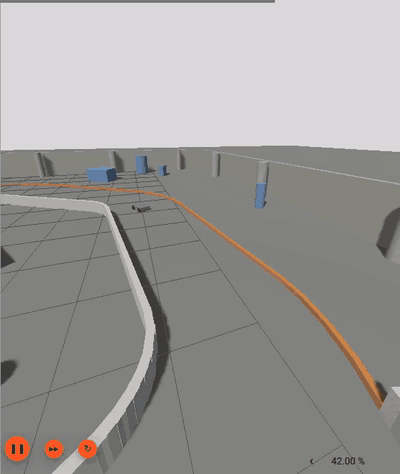

# Deep Drive APEX

ROS 2 autonomy for an RC car, from Gazebo simulation to physical driving.
Learned LiDAR–inertial odometry, SLAM, reconnaissance and map-guided control
share the same driving core across both environments.

## Simulation

The car explores the track, builds its own map and uses that map for subsequent
laps. [Simulation demonstrations, results and setup](simulation/README.md).

## Real vehicle

The accepted physical run completed two laps without contact, with **no reverse
on the second lap**. Lap times were **29.644 / 10.875 s**; the second-lap selected
speed-reference MAE was **0.054 m/s against the onboard estimate**.

[Real-vehicle results, control figures, data and SSH instructions](real_vehicle/README.md)
· [Technical documentation](docs/00_index.md).
