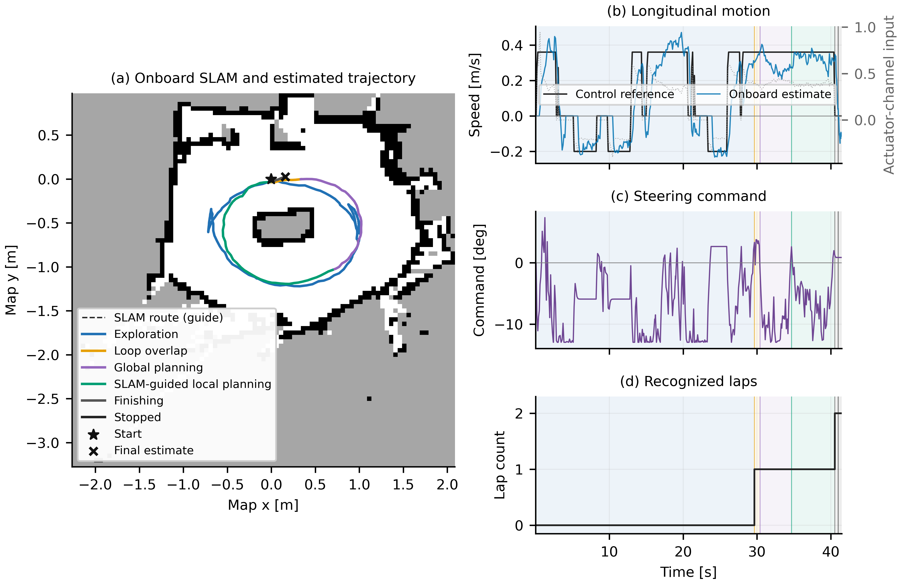
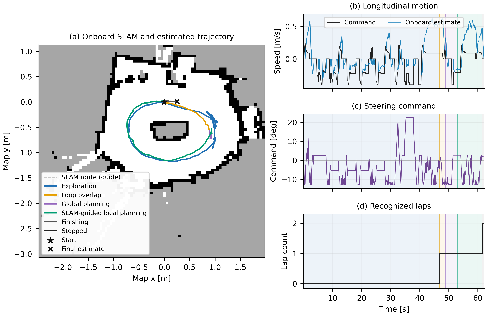
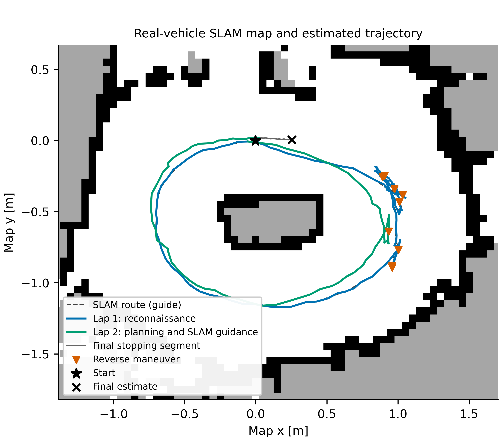

# APEX physical vehicle

The retained implementation is **`apex_race` + `apex_telemetry`**, learned
LiDAR–inertial odometry and `slam_toolbox`, as deployed in operator-approved run
**`20261024_005311`** on October 24, 2026. The old `voiture_system` and curve-entry
flows remain in the tree as earlier implementations.

## Latest accepted calibrated profile

**Run `20261024_220316`** completed two operator-confirmed laps without contact,
with **3 / 0 reverses** and durations **29.644 / 10.875 s**. At the same actual
0.360 m/s reference, selected lap-2 onboard mean / MAE were **0.309 / 0.054 m/s**.
Longitudinal Kalman accepted 12 updates, below the minimum 20, so its inverse
remained inactive. This is successful calibrated operation, not full model
convergence or external odometry accuracy.



[Latest report and complete data/source/model ZIP](docs/paper/20261024_220316/README.md)
include English figures, actual reference tracking, runtime/resource diagnostics,
operator confirmation and 144 matching selected PC/Pi files. The PC launcher
now defaults to this `tracking` profile. Select `--profile approved` for the
original historical settings and data below.



## Historical approved results and downloadable evidence

| Result | Approved run |
| --- | ---: |
| Reconnaissance / second lap | 46.837 / 14.594 s |
| Reverse starts, lap 1 / lap 2 | 8 / 1 |
| Executed second-lap mode | MAP_GUIDED |
| Raw IMU samples / scans | 9,002 / 889 |
| Hybrid processing median / P95 / max | 14.165 / 18.128 / 26.490 ms |
| Propagated pose age at control, median / P95 | 15.000 / 23.240 ms |
| Maximum command publication gap | 45.05 ms |
| Driver / odometry / recorder CPU, median | 96.97 / 31.49 / 11.00% of one core |
| Selected PC/Pi runtime files checked | 138, before and after the trial |

The operator selected this run for its original-like physical response. The
optimized global candidate was rejected, and one reverse recovery remained on
the second lap. Contact with boundaries was not reported. No external trajectory
ground truth or motor electrical measurements were available. CPU percentages
refer to one core, and hybrid processing includes more than network inference.

- [Full report, six English figures, numeric tables and comparison](docs/paper/20261024_005311/README.md)
- [Portable raw-data/source/configuration/model archive](docs/paper/20261024_005311/real_vehicle_20261024_005311.zip), 10,004,574 bytes, 305 verified payload files
- [Archive SHA256](docs/paper/20261024_005311/real_vehicle_20261024_005311.zip.sha256)
- [Acquisition runtime tag](https://github.com/Santiago23florido/Deep-Drive-APEX/tree/real-car-approved-20261024-005311)
- [Earlier full capture](docs/paper/20261024_000432/README.md), retained independently



## Runtime graph

```text
WT61PC IMU (100 Hz) + A2M8 Express LiDAR (10 Hz)
  -> learned hybrid odometry (ONNX + polar ICP)
  -> slam_toolbox -> map / graph / map-to-odometry transform
  -> apex_race driver (reactive lap 1, map-guided continuation)
  -> adaptive command shaping -> Twist-to-actuation bridge -> ESC / servo
```

The stationary hold covers both scan estimates and IMU prediction. The speed
inverse uses learned gain/offset only after independent longitudinal confidence
and residual checks pass. Otherwise, effective gain/offset remain 1/0 while
learning continues. See [the full graph and implementation](docs/race_stack.md).

## Component locations

| Path | Purpose |
| --- | --- |
| `ros2_ws/src/apex_race/` | Driver, local/global planning, lap detection, plant identification and adaptation |
| `ros2_ws/src/apex_telemetry/` | Hardware sensors, device timestamps, actuation bridge and PWM |
| `tools/core/apex_race_up.sh` | Race bring-up, single-owner checks and hardware guards |
| `tools/core/run_ram_capture.py` | Finite RAM-backed capture and verified persistence after stopping |
| `tools/core/validated_trial_20261024_000432/` | Exact helper scripts reused by the approved 005311 run |
| `tools/pc/` | Offline audits and paper plots |
| `arduino/` | Sensor firmware |
| `docs/paper/20261024_005311/` | Approved evidence, metrics, figures and exact portable snapshot |
| `ros2_ws/src/voiture_system/` | Earlier SLAM/Nav2 vehicle implementation |

The shared driving core is checked against `simulation/` for byte and semantic
parity. Hardware-specific configuration and I/O remain separate. Build the real
and simulated workspaces independently.

## Deployment and capture

From the PC, use [`tools/pc/race_pi.sh`](tools/pc/race_pi.sh): `status` reads
the state, `preflight` runs the disarmed checks and stops, and `run` launches
the finite recognition-to-SLAM trial with RAM-backed capture. The
[main README](../README.md#from-the-pc-ssh-preflight-and-recognition-to-slam-run)
provides the complete SSH commands, prerequisites, deployment and output paths.

An opt-in [forward speed calibration profile](docs/calibration/speed_initialization_20261024/README.md)
keeps the control law and network weights, and targets the approved physical
pace through a calibrated forward PWM map. Use
`./real_vehicle/tools/pc/race_pi.sh --profile initialized run` from the repository
root for its experimental trial, or add `--dry-run` before `run` to preview it
without connecting. The command syncs and verifies the required files first.
The [physical follow-up](docs/calibration/speed_initialization_20261024/physical_trial_190956/README.md)
completed two laps but did not meet the speed-tracking objective. Weak feedback
after the unit conversion and the simulation failures are recorded in the
report. Its historical approved settings remain selectable explicitly.

The [renewed-battery / raised-boundary follow-up `211216`](docs/calibration/speed_initialization_20261024/physical_trial_211216/README.md)
used that approved profile and completed two operator-confirmed laps without
contact: 43.842 / 33.922 s, with 6 / 4 reverse starts. Its separate reference
logging exposes the remaining speed-calibration mismatch. The report includes
time-weighted tracking diagnostics, English figures and raw-data locations.

The later [longitudinal-only `tracking` profile](docs/calibration/speed_initialization_20261024/tracking_followup/README.md)
retains that steering/recovery selection and reached its two-lap stop in run
`214635`: 28.724 / 25.650 s, with 4 / 2 reverses. The operator reported multiple
physical laps. Forward reference 0.360 m/s versus selected lap-2 onboard speed
0.256 m/s leaves MAE 0.106 m/s. It remains an experiment with unaccepted
longitudinal adaptation. From the PC, `./real_vehicle/tools/pc/race_pi.sh --profile tracking run`
selects its finite captured trial; add `--dry-run` before `run` to preview.
The later accepted refinement is now the default `tracking` profile; the former
acquisition is preserved.

The recorded Pi root is `/home/ensta/AiAtonomousRc/APEX`; it contains this
directory's contents. Learned-odometry dependencies and weights are mounted
separately from `/home/ensta/odom_rt`. Follow the
[race-stack guide](docs/race_stack.md) and
[approved launcher instructions](tools/core/validated_trial_20261024_000432/README.md)
for the exact setup.

The finite profile retains two laps, 40 m estimated travel, 300 s, 0.40 m/s
command caps, geometry-checked reverse recovery, and arm/power/sensor guards.
Directional steering limits are nominal command units, not measured wheel
angles. A trial starts with fresh mapping, odometry and adaptation state.

Trial outputs go to RAM while driving. After neutral and shutdown, the wrapper
copies, verifies and fsyncs them to persistent storage before removing RAM data.
This does not disable all operating-system or Docker logging. See
[RAM capture details](docs/ram_logging.md).

## Offline work and publication

The approved ZIP includes `verify_archive.py`, `reproduce_figures.py` and analysis
requirements. Extract it and follow its README to verify and regenerate figures
without ROS or a car. Preserve the sealed ZIP and its hash when producing new
analysis in a separate directory.

See the [real evaluation protocol](docs/real_evaluation_protocol.md) and
[preprint readiness report](../docs/reports/preprint_readiness_20261024.md).
The remaining final-version simulation campaign can run after access to the
vehicle ends. Existing real captures support deployment, timing and internal
consistency reporting; they do not provide absolute pose error or a controlled
zero-shot benchmark of the entire stack.
