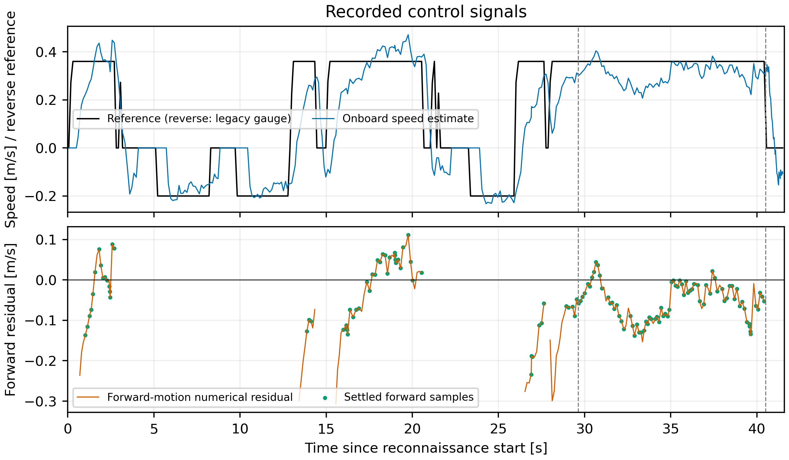
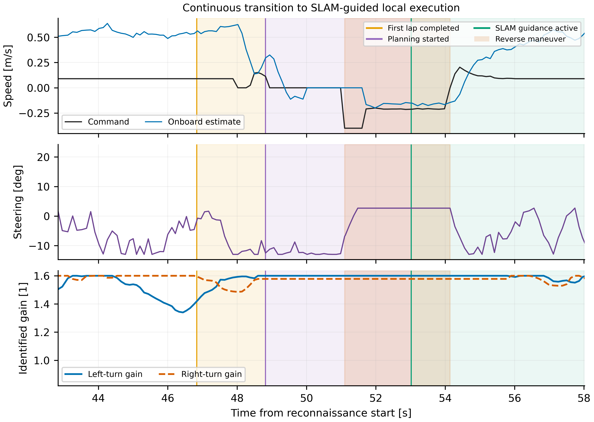
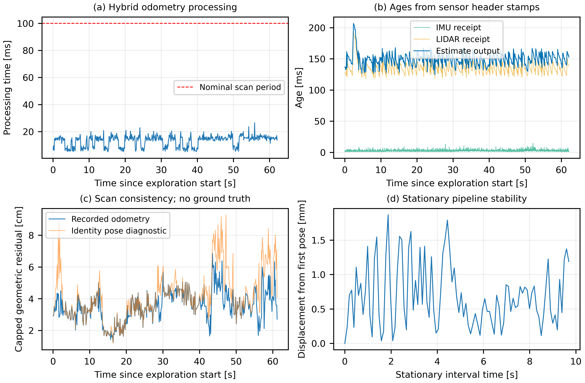
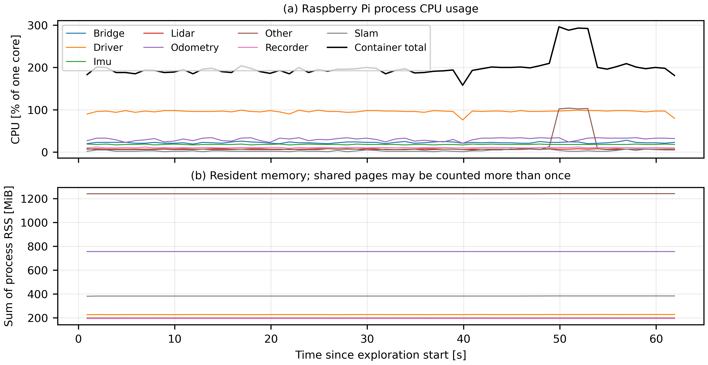

# APEX physical vehicle

The active implementation combines **`apex_race`**, **`apex_telemetry`**, learned
LiDAR–inertial odometry and `slam_toolbox` on the Raspberry Pi. The latest
accepted calibrated configuration is profile **`tracking`**, recorded in run
**`20261024_220316`**. Earlier captures and implementations remain available.

## Latest accepted calibrated physical result

The operator confirmed **run `20261024_220316`** completed two physical laps
without contact and **without a second-lap reverse**. This is the current
recommended PC profile, `tracking`; the historical `approved` profile and
sealed 005311 data remain available separately.


| Quantity | Reconnaissance | Second lap |
| --- | ---: | ---: |
| Duration | 29.644 s | 10.875 s |
| Reverse starts | 3 | **0** |
| Selected forward reference | 0.360 m/s | 0.360 m/s |
| Selected onboard speed mean | 0.337 m/s | 0.309 m/s |
| Selected mean absolute reference residual | 0.064 m/s | **0.054 m/s** |

The second lap used SLAM/map-guided local planning; its optimized global
candidate was rejected for curvature and clearance. The full second-lap MAE
was 0.0555 m/s. Measurements are onboard estimates, with no external ground truth.



- [Complete accepted report, English figures and interpretation](docs/paper/20261024_220316/README.md)
- [Download data, source, configuration and model archive](docs/paper/20261024_220316/real_vehicle_20261024_220316.zip), [SHA256](docs/paper/20261024_220316/real_vehicle_20261024_220316.zip.sha256)
- [Runtime tag](https://github.com/Santiago23florido/Deep-Drive-APEX/tree/real-car-calibrated-20261024-220316), [144-file PC/Pi manifest](docs/paper/20261024_220316/runtime_manifest.json)

## Online identification and future track variation

The controller combines calibrated feedforward, bounded speed feedback and
online Kalman plant identification. It records parameter estimates, update
counts, uncertainty and application decisions throughout reconnaissance and
map-guided execution. The actual run-specific statistics and measurement scope
are preserved in the [accepted identification report](docs/paper/20261024_220316/README.md#kalman-identification-active-not-fully-converged).

A track with more variation in curvature and commanded speed could provide
richer excitation, improve parameter observability and support stronger Kalman
identification confidence and parameter convergence. This is a hypothesis for
a future evaluation; the two-lap result does not measure performance on that
more varied track.

The accepted demonstration shows continuous recognition-to-SLAM operation,
no boundary contact and no second-lap reverse. Its recorded second-lap mode is
MAP_GUIDED: the observed route guides live footprint-checked local arcs. The
[planning details](docs/paper/20261024_220316/README.md#slam-and-the-absence-of-a-second-lap-reverse)
retain the global candidate checks and the distinction between map guidance
and direct optimized-raceline tracking.

## From the PC: SSH preflight and recognition-to-SLAM run

The PC entry point is [`real_vehicle/tools/pc/race_pi.sh`](tools/pc/race_pi.sh).
Run these commands from the repository root. It uses the `ensta` account,
noninteractive SSH and passwordless `sudo` on the prepared Pi. The deployed
runtime root is **`/home/ensta/AiAtonomousRc/APEX`**, containing `real_vehicle/`'s
contents; the estimator environment is separate at `/home/ensta/odom_rt`.

```bash
# Read the current state; no new trial.
./real_vehicle/tools/pc/race_pi.sh --host ensta@raspberrypi status

# Fresh pre-run: sensors, stationary odometry, SLAM, parameters, command gaps,
# recorder and power checks. Disarmed throughout, then shuts the stack down.
./real_vehicle/tools/pc/race_pi.sh --host ensta@raspberrypi preflight

# With the car at the start and the track clear: this command MOVES the car.
# Fresh recognition lap -> automatic SLAM/map-guided continuation -> stop.
./real_vehicle/tools/pc/race_pi.sh --host ensta@raspberrypi run
```

The default is the accepted calibrated `tracking` profile. Use `--profile approved`
for the historical settings. Use `--dry-run` to preview without connecting.
The wrapper refuses a new preflight/run if `apex_pipeline` already exists. It
deploys and SHA256-verifies 13 explicit runtime files for the calibrated profiles,
and reuses the exact [CPU/capture helper copies](tools/core/validated_trial_20261024_000432/README.md).

| PC mode | Pi script | Effect |
| --- | --- | --- |
| `preflight` | `data/diagnostics/20261022_open_segment/run_oval_initialized.py --diagnose-only --forward-profile tracking` | Calibrated onboard checks; never publishes `arm=true`; captures diagnostics and stops |
| `run` | `sudo python3 tools/core/run_ram_capture.py --root /home/ensta/AiAtonomousRc/APEX --profile tracking --execute` | Accepted two-lap capture on RAM, temporary 2.0 GHz CPU ceiling, then verified persistent copy |

The run retains two laps, at most **40 m estimated / 300 s**, forward/reverse
actuator-channel caps of **1.43 / 0.40**, with PWM ceilings **28.2 / 31.2**;
actual forward references remain **0.36–0.42 m/s**. It resets odometry/map/adaptation and retains onboard
arm/power/sensor guards. Mapping runs during recognition; the transition starts
from the current pose. A feasible global plan can be tracked, otherwise the
guarded MAP_GUIDED fallback uses the mapped/observed route. The latest accepted
run used that fallback without a lap-2 reverse; recovery remains available.

The standalone preflight writes diagnostics to persistent storage at the normal
CPU ceiling; `run` repeats its preflight inside the original RAM/2.0 GHz trial
wrapper. The detailed bring-up grader is
[`race_bringup_check.py`](ros2_ws/scripts/race_bringup_check.py).
No finite check proves battery condition at the motor terminals.

On the Pi, new evidence is under `APEX/ros2_ws/apex_race/<run>/` and
`APEX/data/diagnostics/20261022_open_segment/`. Wait for
**"RAM evidence copied and SHA256-verified after stop"** and inspect the final
run/arm report before removing power; an SSH exit alone is not a lap verdict.
For an already stopped vehicle, code deployment is:

```bash
./real_vehicle/tools/core/sync_apex_code_to_pi.sh \
  ensta@raspberrypi:/home/ensta/AiAtonomousRc/APEX/ \
  --exclude '/docs/' --exclude '/data/'
# Estimator source/weights are separate; explicitly choose the retained v7e model.
APEX_PI_HOST=ensta@raspberrypi \
APEX_ODOM_CKPT_DIR=simulation/learning/outputs/real2sim_v7e_standstill/hybrid_submap_v4 \
  ./real_vehicle/tools/core/sync_odom_rt_to_pi.sh
```

The latter command requires both PT/ONNX files locally; the exact deployed
copies are in the approved archive. The sync helper's historical default is v5,
so keep the explicit v7e path. See the [race-stack guide](docs/race_stack.md)
for dependencies and hash checks. These commands are instructions for a future
trial; repository publication does not launch the vehicle.

## Runtime graph

```text
WT61PC IMU (100 Hz) + A2M8 Express LiDAR (10 Hz)
  -> learned hybrid odometry (ONNX + polar ICP)
  -> slam_toolbox -> map / graph / map-to-odometry transform
  -> apex_race driver (reactive lap 1, map-guided continuation)
  -> adaptive command shaping -> Twist-to-actuation bridge -> ESC / servo
```

The stationary hold covers both scan estimates and IMU prediction. The speed
inverse uses learned gain/offset only after independent longitudinal confidence
and residual checks pass. Otherwise, effective gain/offset remain 1/0 while
learning continues. See [the full graph and implementation](docs/race_stack.md).

## Component locations

| Path | Purpose |
| --- | --- |
| `ros2_ws/src/apex_race/` | Driver, local/global planning, lap detection, plant identification and adaptation |
| `ros2_ws/src/apex_telemetry/` | Hardware sensors, device timestamps, actuation bridge and PWM |
| `tools/core/apex_race_up.sh` | Race bring-up, single-owner checks and hardware guards |
| `tools/core/run_ram_capture.py` | Finite RAM-backed capture and verified persistence after stopping |
| `tools/core/validated_trial_20261024_000432/` | Exact helper scripts reused by the approved 005311 run |
| `tools/pc/` | Offline audits and paper plots |
| `arduino/` | Sensor firmware |
| `docs/paper/20261024_220316/` | Latest accepted calibrated evidence, figures, source/model manifest and portable snapshot |
| `docs/paper/20261024_005311/` | Preserved original approved evidence and portable snapshot |
| `ros2_ws/src/voiture_system/` | Earlier SLAM/Nav2 vehicle implementation |

The shared driving core is checked against `simulation/` for byte and semantic
parity. Hardware-specific configuration and I/O remain separate. Build the real
and simulated workspaces independently.

## Capture and reproducibility

The latest portable archive contains **311 hashed payload files**, including
raw sensors, maps, commands, actual references, runtime resources and exact
source/configuration/model snapshots. The 97 downloaded trial payloads matched
the Pi's post-stop RAM inventory; 144 selected runtime files matched PC/Pi.
The PT/ONNX weights are unchanged. Offline extraction, payload verification and
all four figure-reproduction commands passed, reproducing tracking metrics
exactly. See [the archive and verification records](docs/paper/20261024_220316/README.md#evidence-exact-source-and-reproduction).

Trial output is recorded in RAM, then copied, SHA256-verified and fsynced after
neutral and shutdown. This does not disable operating-system or Docker logging.
The profile starts with fresh mapping, odometry and adaptation state. Nominal
steering limits are command units, not independently measured wheel angles.
See [RAM capture details](docs/ram_logging.md).

## Historical approved physical implementation

On October 24, 2026, the operator selected **run `20261024_005311`** after
confirming successful two-lap operation at the desired original-like speed.
The exact acquisition runtime is tagged
[`real-car-approved-20261024-005311`](https://github.com/Santiago23florido/Deep-Drive-APEX/tree/real-car-approved-20261024-005311).
Subsequent documentation and simulator tests do not change that snapshot.


| Development run | Reconnaissance lap | Second lap | Reverse starts, lap 1 / 2 |
| --- | ---: | ---: | ---: |
| Original reference `20261023_222959` | 34.209 s | 14.844 s | 5 / 1 |
| Earlier full capture `20261024_000432` | 83.823 s | 42.773 s | 13 / 4 |
| **Approved `20261024_005311`** | **46.837 s** | **14.594 s** | **8 / 1** |

The second lap executed **MAP_GUIDED** local planning using SLAM and the observed
route. The optimized global candidate was rejected by feasibility checks. One
reverse recovery remained on lap 2. The operator confirmed physical operation;
contact with boundaries was not reported. Maps and trajectories below are
onboard estimates, with no external motion ground truth.

### Data, timing and Raspberry Pi measurements

| Quantity, approved run | Recorded value | Interpretation |
| --- | ---: | --- |
| Raw IMU / LiDAR / receipt records | 9,002 / 889 / 9,891 | Schema, count, time and critical finite-field checks passed |
| Hybrid odometry processing, median / P95 / max | 14.165 / 18.128 / 26.490 ms | Includes preprocessing, ICP/network or stationary hold, deskew and integration |
| Scan stamp to estimate output, median / P95 | 149.165 / 164.091 ms | Includes acquisition and waiting; distinct from processing time |
| Propagated pose age at control, median / P95 | 15.000 / 23.240 ms | IMU propagation does not supply a new LiDAR correction |
| Maximum command publication gap | 45.05 ms | No recorded bridge timeout, stale-data stop or core-busy stop |
| Odometry / driver / recorder CPU, median | 31.49 / 96.97 / 11.00% of one core | Driver has little headroom on its assigned core |
| Container CPU, median | 195.95% of one core | About two cores; not 195.95% of the whole four-core host |
| Odometry RSS | 756.72 MiB | Resident memory, not total system memory |
| Stationary maximum estimated excursion | 1.866 mm over 9.696 s | Full pipeline with stationary hold, not model-only accuracy |
| Scan consistency mean | 0.03520 m | Correlated geometric diagnostic, not absolute position error |
| Forward command median / positive ESC snapshot median | 0.09 m/s / 17.97 ESC-percent | Commanded values; both match the original reference |
| LiDAR header intervals above 150 ms | 4 | Preserved in the data; no stale-data stop recorded |
| Live Pi power fault samples | 0 | Motor terminal voltage/current were not measured |

Trial output was written to RAM and persisted after stopping with SHA256 checks
and `fsync`. All **138 selected runtime files** matched PC/Pi before and after
the trial. The portable archive contains **305 verified payload files**, including
raw sensors, commands/PWM, maps, resources, exact source/configuration/model
snapshots, operator feedback and offline reproduction scripts.

- [Download the complete archive, 10,004,574 bytes](docs/paper/20261024_005311/real_vehicle_20261024_005311.zip)
- [SHA256](docs/paper/20261024_005311/real_vehicle_20261024_005311.zip.sha256): `cdcda4bf8d42be5b5ab841ccaa8c70922119a268e8fce094cbc143ffacaf2721`
- [Capture details and measurement definitions](docs/paper/20261024_005311/README.md)
- [Metrics CSV](docs/paper/20261024_005311/paper_metrics.csv), [LaTeX table](docs/paper/20261024_005311/paper_timing_table.tex), [run comparison](docs/paper/20261024_005311/run_comparison.csv)

### Figures for the paper

All six figures have English labels, vector PDF/SVG and 600 dpi PNG exports.
The ZIP includes the data and scripts used to reproduce them offline.

| SLAM map and estimated laps | Transition to map-guided control |
| --- | --- |
|  |  |
| **Odometry consistency and timing** | **Raspberry Pi resources** |
|  |  |

The [lap comparison](docs/paper/20261024_005311/figures/single_run_lap_comparison.pdf)
completes the six-figure set. Scan consistency is a correlated pipeline
diagnostic, not absolute odometry error or ATE/RPE. These development repeats
used different online estimates, maps and unmeasured battery conditions; their
comparison does not establish a controlled ablation or a statistical success rate.

### Retained control correction

The Kalman identifier continues fitting longitudinal gain and offset, but control
uses them only when independent longitudinal confidence reaches **0.5** and the
existing sample-count/residual gates pass. Until then, effective gain/offset
remain **1/0**. This prevents an underdetermined fit after a few low-speed or
reverse observations from suppressing the forward command. Steering adaptation
and deadband/launch learning continue.

The approved run ended with raw confidence **0.421**, raw gain/offset
**0.6 / 0.0203**, and `longitudinal_applied=false`; effective values stayed 1/0.
No neural weights were retrained for this correction. Real and simulated driving
cores are checked for byte and semantic parity.

An opt-in [forward speed calibration experiment](docs/calibration/speed_initialization_20261024/README.md)
normalizes the hardware speed-to-PWM map while retaining the control law and
approved pace. It adds explicit reference logging. Motor simulation passes;
full-track integration has documented failures. A [physical follow-up](docs/calibration/speed_initialization_20261024/physical_trial_190956/README.md)
completed two laps but exposed weak PWM feedback and persistent speed error.
Further [initialized-profile trials](docs/calibration/speed_initialization_20261024/feedback_correction/README.md)
failed at the first curve. After a renewed battery and a raised inner boundary,
[run `211216` using the approved profile](docs/calibration/speed_initialization_20261024/physical_trial_211216/README.md)
completed two operator-confirmed laps without contact, in 43.842 / 33.922 s,
with 6 / 4 reverse starts. Its settled second-lap nominal reference was 0.150
against a 0.354 m/s onboard estimate; physical speed tracking remains unvalidated.
The historical approved profile remains selectable with `--profile approved`. With a prepared,
stationary car on a clear track, `./real_vehicle/tools/pc/race_pi.sh --profile initialized run`
deploys the hash-checked payload and performs the bounded experimental trial.
This command moves the car. Preview it with `--dry-run` before `run`.

The separate [longitudinal-only `tracking` follow-up, run `214635`](docs/calibration/speed_initialization_20261024/tracking_followup/README.md)
reached the two-lap stop in 28.724 / 25.650 s, with 4 / 2 reverse starts. The
operator reported multiple physical laps. Its actual forward reference was
0.360 m/s; selected second-lap onboard mean / MAE were 0.256 / 0.106 m/s.
Longitudinal confidence remained below acceptance. Use `--profile tracking`
explicitly for this calibrated experiment; it retains the approved steering
and reverse selection. Its later refinement is the accepted default above; this earlier trial does not establish
accurate speed tracking or untouched zero-shot full-stack transfer.

## Offline work and publication

The approved ZIP includes `verify_archive.py`, `reproduce_figures.py` and analysis
requirements. Extract it and follow its README to verify and regenerate figures
without ROS or a car. Preserve the sealed ZIP and its hash when producing new
analysis in a separate directory.

See the [real evaluation protocol](docs/real_evaluation_protocol.md) and
[preprint readiness report](../docs/reports/preprint_readiness_20261024.md).
The remaining final-version simulation campaign can run after access to the
vehicle ends. Existing real captures support deployment, timing and internal
consistency reporting; they do not provide absolute pose error or a controlled
zero-shot benchmark of the entire stack.

## Repository and documentation

| Path | Role | Start here |
| --- | --- | --- |
| `simulation/` | Gazebo sensors, learned odometry, race core, evaluation and datasets | [Simulation README](../simulation/README.md) |
| `real_vehicle/` | Approved `apex_race` + `apex_telemetry` hardware implementation | [Real vehicle README](README.md) |
| `real_vehicle/docs/paper/` | Versioned real captures, figures, hashes and portable archives | [Latest accepted run](docs/paper/20261024_220316/README.md), [original approved run](docs/paper/20261024_005311/README.md) |
| `docs/` | Architecture, setup and publication evidence | [Documentation index](../docs/00_index.md) |
| `archive/` | Historical stacks and local generated artifacts | [Archive README](../archive/README.md) |

The older `voiture_system`, curve-entry and recognition-tour flows remain for
compatibility and historical reference. They are not the approved race runtime.
The [race-stack guide](docs/race_stack.md) documents the hardware
graph and deployment. Offline plots and unit tests need no vehicle connection.
