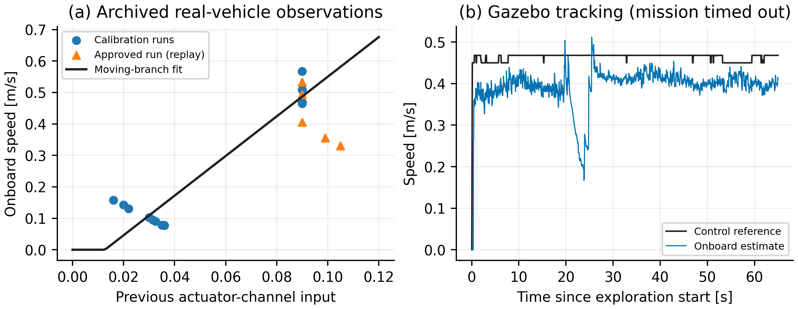

# Forward speed calibration — October 24, 2026

**Development profile; speed tracking remains unvalidated.** The offline work
below was performed with the car disconnected. A subsequent
[physical trial, 20261024_190956](physical_trial_190956/README.md), completed two
operator-confirmed laps, but exposed weak proportional PWM correction and
persistent speed-reference error. That review records the complete result and
the required feedback unit conversion. The approved acquisition remains run `20261024_005311`, tagged
`real-car-approved-20261024-005311`. Its source snapshot, raw measurements,
archives and published figures have not been replaced.

This profile retains the geometric controller, bounded proportional speed
feedback and online Kalman identification. It calibrates the forward hardware
conversion and declares speed references near the observed pace. It does not
modify odometry network weights, rescale the measured velocity, manufacture a
reference trace for an old run or force identifier confidence. Retraining the
odometry network is not required for this hardware conversion.



## Why the previous speed traces differed

The old CSV `v_cmd` was the final actuator-channel input after inverse-model,
feedback and launch shaping. The planner's actual reference was not logged.
The forward bridge used `PWM = 15 + 33 * input`, so the approved median input
`0.09` produced PWM `17.97`. That input was not a calibrated physical speed.

In the old gauge, nearly all approved forward-command time was below the
identifier's initial deadband learning gate (`0.07 + 0.15 = 0.22`). The effective
longitudinal model stayed at gain/offset `1/0`: its confidence did not meet the
independent `0.5` gate. Plotting the actuator input against onboard velocity
therefore mixed two quantities. This does not establish that odometry is
accurate, or that power and latency never affected other runs.

## Calibration and pace

The offline fit uses 14 moving-segment medians from development runs
`20261023_222959` and `20261024_000431` (the latter archive contains the
`000432` capture). Five segments from approved run `20261024_005311` are used
for replay comparison, not fitting. Selection, source hashes and all medians
are in [fit.json](fit.json).

The approximate moving branch is:

```text
onboard_speed = 6.3 * old_forward_input - 0.08
new_forward_PWM = 15.42 + 5.24 * requested_speed
```

At `0.50 m/s`, the new conversion gives **18.04 PWM**, versus **17.97** for the
approved median. The intended physical pace is therefore close to the selected
run. The actual response still depends on the battery, load and estimator.

| Setting | Approved profile | Initialized profile |
| --- | ---: | ---: |
| Exploration maximum / minimum | 0.20 / 0.15, old command gauge | 0.55 / 0.45 m/s |
| Race maximum | 0.20, old command gauge | 0.55 m/s |
| Forward bridge intercept / slope | 15 / 33 | 15.42 / 5.24 |
| Forward command ceiling | 0.40 | 2.40, new forward gauge |
| Maximum forward PWM | 28.2 | 28.2 (command ceiling maps to 27.996) |
| Reverse map / command ceiling / PWM ceiling | 18 + 33·abs(input) / 0.40 / 31.2 | Same |
| Steering limits, left / right | 22.5° / 12.96° | Same |
| Laps / estimated distance / duration bounds | 2 / 40 m / 300 s | Same |
| Kalman initial gain / offset / confidence | 1 / 0 / 0 | Same |

The confidence envelope can lower the actual forward reference, initially to
approximately `0.4675 m/s`. References are used directly. Forward deadband and
launch ramp are expressed in the new command units; reverse launch and inverse
commands retain their approved gauge. The identifier fits forward samples only,
accepts steady same-direction overspeed and keeps its acceleration, uncertainty,
sample-count and confidence gates. Steering estimation and recovery logic remain.
One small shared correction preserves the sign of a negative longitudinal
intercept when inverting the learned model.

`driver.csv` now appends `v_target` (actual control reference) and
`v_model_steady` (effective model's steady prediction, not a measurement).
Forward references have the calibrated speed meaning; reverse retains the
legacy actuator gauge and must be analyzed separately. New evidence plots put
the actuator input on a separate axis when the reference is available. Old
captures are explicitly labeled as lacking that reference.

## Validation, including failures

| Check | Result | Scope |
| --- | --- | --- |
| Real workspace, telemetry and PC tools | 289 passed | Includes calibration, forward/reverse isolation, approved defaults and SSH boundary |
| Simulation research suite | 204 passed | Shared-core and existing simulation regression tests |
| Motor simulation, nominal and ±15% gain | Passed all three cases | Same control law; mean settled reference error <0.075 m/s; median speed >0.4 m/s |
| Two-dimensional track replica, seed 1 | Completed two laps, 42.62 / 65.78 s | Minimum simulated clearance 0.104 m |
| Two-dimensional track replica, seed 2 | Failed: stuck in exploration | Retained failure, not a success-rate study |
| Seed 2 with minimum reference 0.40 | Failed: stuck in MAP_GUIDED after lap 1 | Follow-up only; this parameter was not adopted |
| Full Gazebo, learned v7e + ICP + SLAM, seed 1 | Failed: mission timeout | About three physical simulator laps; driver recognized only one |
| New physical run | Not performed | Vehicle disconnected; Pi not updated during this work |

In the Gazebo run, forward-moving samples had a time-weighted reference mean
of **0.4584 m/s**, onboard mean **0.3988 m/s** and absolute tracking difference
**0.0601 m/s**. Selection is `v_target > 0.1`, onboard speed `> 0.05`, positive
time interval. This measures tracking against the onboard estimate, not odometry
accuracy. It is not a comparison of two controlled physical trials.

Gazebo truth recorded lap times `47.62 / 59.36 / 55.54 s`, but the driver counted
only one lap and never finished. SLAM evaluation found ATE RMSE `5.305 m`;
later estimated positions did not return near the original start. The failure
is consistent with localization drift affecting closure. Its root cause has not
been isolated. The start detector was not relaxed to force a pass. Also, that
launcher loaded the standard simulator vehicle YAML, overriding the requested
individual deadband field: the initial logged threshold was `0.07`, not the
physical profile's `0.36`. This run is a shared-control integration experiment,
not exact validation of the complete initialized physical configuration.

The replica is approximately 20.6 m per lap, longer than the physical track.
Simulation trials used distance/time bounds of 100 m / 400 s; physical bounds
remain 40 m / 300 s. Complete trial summaries, including failures, are in
[simulation_trials.json](simulation_trials.json); time-weighted metrics and
Gazebo source hashes are in [validation.json](validation.json). The complete raw
Gazebo run remains local under
`simulation/data/real2sim/initialized_speed_v7e_20261024_s1/`.

Both old and new plot schemas were exercised offline. The new-schema smoke
fixture uses explicitly synthetic targets and is excluded from paper evidence.
The four canonical acquisition helpers match the approved tag byte for byte.
The four modified real/simulation core files are byte-identical. Shell syntax
checks passed; no SSH connection or actuator command was sent.

## After reconnecting the car

From the repository root, with the car stationary at the start and the track
clear, the opt-in command deploys the explicit ten-file payload, checks each
SHA256, performs the existing disarmed preflight, then moves the car:

```bash
./real_vehicle/tools/pc/race_pi.sh --profile initialized run
```

No extra moving calibration trial is required. The normal warmup and power
checks remain. The trial resets the map, odometry and adaptation, performs
recognition followed by SLAM/map-guided continuation, captures to RAM and copies
evidence to persistent storage after stopping. This is an experimental physical
validation command; complete two-lap performance is not yet established.

To inspect that command without connecting:

```bash
./real_vehicle/tools/pc/race_pi.sh --profile initialized --dry-run run
```

The default `--profile approved` still selects the approved settings and helper
copies. Choose it to reproduce the retained baseline rather than this experiment.
The initialized sync touches only the explicit runtime payload, refuses an
existing `apex_pipeline` container and requires neutral/disabled motor output.
It does not deploy network weights. A standalone disarmed check is available
with `--profile initialized preflight`, but `run` already includes that check.

## Reproduce offline analysis

```bash
PY=simulation/learning/.venv/bin/python
$PY real_vehicle/tools/pc/fit_speed_prior.py \
  --train archive/generated/paper/real_vehicle_20261023_222959/raw/ros_run \
          archive/generated/paper/real_vehicle_20261024_000431/raw/ros_run \
  --validation archive/generated/paper/real_vehicle_20261024_005311/raw/ros_run \
  --output real_vehicle/docs/calibration/speed_initialization_20261024/fit.json
$PY real_vehicle/tools/pc/report_speed_calibration.py \
  --fit real_vehicle/docs/calibration/speed_initialization_20261024/fit.json \
  --gazebo-run simulation/data/real2sim/initialized_speed_v7e_20261024_s1 \
  --output real_vehicle/docs/calibration/speed_initialization_20261024
$PY -m pytest -q real_vehicle/ros2_ws/src/apex_race/test \
  real_vehicle/ros2_ws/src/apex_telemetry/test \
  real_vehicle/tools/pc/test_audit_real_run.py \
  real_vehicle/tools/pc/test_race_pi.py real_vehicle/tools/pc/test_fit_speed_prior.py
$PY -m pytest -q simulation/ros2_ws/src/apex_fusion_research/test
```

For the paper, describe this as post-deployment hardware calibration using
onboard estimates. Unchanged odometry weights are compatible with a fixed-model
transfer claim, but this adjusted controller configuration is not untouched
zero-shot full-stack evidence. The original approved data remain the physical
result until a new trial is completed and checked.
