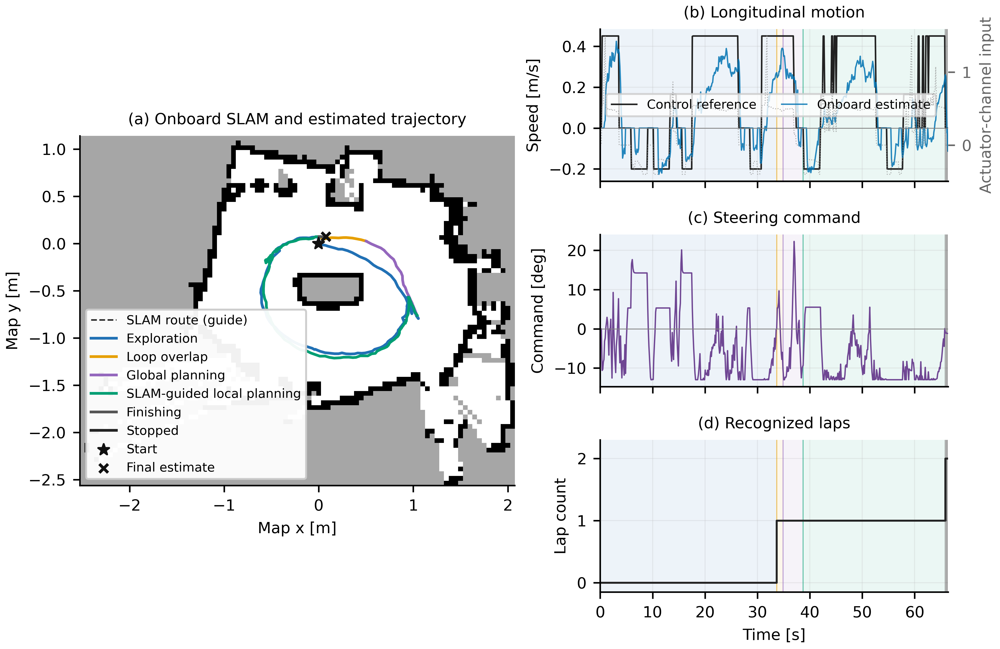

# Physical follow-up: run 20261024_190956

**Navigation completed; speed-tracking acceptance was not met.** The operator
confirmed two physical laps, a somewhat slower second lap and an additional
reverse. Boundary contact was not reported. The motor was verified at 7.5%
neutral after stopping and the vehicle container was removed. This run does not
replace approved acquisition `20261024_005311`.

The initialized profile ran from commit `65cbe2c`. Its ten-file payload was
copied to the Pi and every file's SHA256 checked before starting. No controller
parameters or neural weights were changed during or after the trial. Output was
captured to RAM and copied to durable storage after stopping with hash checks.

## Outcome and comparison

| Measurement | Approved 005311 | Initialized 190956 |
| --- | ---: | ---: |
| Reconnaissance lap | 46.837 s | 33.581 s |
| Second lap | 14.594 s | 32.261 s |
| Reverse starts, lap 1 / lap 2 | 8 / 1 | 4 / 2 |
| Forward-moving onboard mean, lap 2 | 0.412 m/s | 0.219 m/s |
| Second-lap mode | MAP_GUIDED | MAP_GUIDED |
| Effective final longitudinal gain / offset | 1 / 0 | 1 / 0 |
| Longitudinal confidence | 0.421 | 0.337 |
| Learned longitudinal inverse applied | No | No |

The first lap improved, with fewer reverses. The second lap was about 2.21 times
the approved second-lap duration. It was slightly shorter than this run's own
first lap. These are development repeats with different online estimates,
learned maps, unmeasured battery conditions and initial placement; they are not
a controlled ablation.

For **9.662 s of settled forward motion on lap 2**, the time-weighted actual
reference was **0.4364 m/s**, onboard estimate **0.2401 m/s**, and mean absolute
tracking difference **0.1962 m/s**. Selection requires a positive reference above
0.1 m/s, reference range below 0.025 m/s over the preceding approximately 0.8 s,
no recovery in that window and onboard speed above 0.05 m/s. Values are compared
at their recorded timestamps, without shifting or fitting estimates to targets.
This does not meet the intended close-reference tracking behavior.

## Identified implementation issue

The forward bridge slope changed from 33 to 5.24 PWM points per actuator input,
but proportional speed feedback retained `kp_speed=0.25`. Its electrical
response to an unsaturated error therefore became 6.30 times weaker:

| Same speed error: 0.20 m/s | Additional PWM |
| --- | ---: |
| Previous bridge, `33 * 0.25 * 0.20` | 1.65 |
| Initialized bridge, `5.24 * 0.25 * 0.20` | 0.262 |

The feedback authority bound was also left in the previous parameterization.
At a 0.45 m/s reference, its current limit is 0.09 new command units, or only
0.4716 PWM points. Thus the initialization preserved the approximate nominal
PWM, but did **not** preserve the strength or range of corrective PWM. This
is a concrete omission in the unit conversion, not proof that it explains
every difference between the physical runs. The conversion must include
feedback gain and authority before claiming equivalent speed correction.

The Kalman identifier accumulated 164 longitudinal updates but ended at
confidence **0.3368**, below the required **0.5**. The raw fitted gain/offset
were `0.6126 / 0.2140`; their inverse remained unapplied. The existing
confidence gate behaved as designed. It must not be bypassed to make a plot
look better. Steering confidence also ended at zero because its residual
statistic was `6.009`, above the configured consistency threshold `3.0`.
The complete adaptive model cannot be described as converged in this run.

## Timing and power evidence

- Maximum driver publication gap: **42.1 ms**; bridge's run-lifetime maximum,
  including preflight: **65.75 ms**. No bridge timeout samples, core-busy stops
  or propagated-pose-age stops were recorded.
- Hybrid odometry processing median / P95 / maximum:
  **15.01 / 19.45 / 26.38 ms**. Propagated-pose age median / P95:
  **14.8 / 21.38 ms**.
- The driver recorded **five control cycles stopped for an old LiDAR
  correction**. Raw LiDAR timing included a **453.017 ms** maximum interval.
  These are retained timing faults; they do not establish sustained ROS/buffer
  congestion as the cause of the second-lap slowdown.
- No live Pi undervoltage/throttle samples were recorded. Historical bits
  `0x50000` were present. Motor terminal voltage/current were not measured,
  so motor power limitations cannot be confirmed or ruled out.

The velocity used by the proportional loop comes from IMU-propagated body
velocity; identification uses odometry pose increments converted to rear-axle
arc speed. A saved diagnostic shows differences between these correlated
signals. Neither is external ground truth, and neither should be rescaled to
force agreement with the desired speed. This also limits interpretations of
the plotted tracking error as physical speed error.

## Retained evidence and next correction

The complete downloaded acquisition is local under
`archive/generated/paper/real_vehicle_20261024_190956/`: raw ROS logs, passive
IMU/LiDAR records, map, driver inputs, resource probes, runtime source snapshot,
operator feedback, comparison, timing audit and English PDF/SVG/PNG figures.
All **94 downloaded trial payload files** match the post-stop RAM inventory.
Four acquisition helper files were additionally recovered from local sources
and checked against that inventory. Two transient wrapper/pointer files are
listed separately in [copy_verification.json](copy_verification.json).

- [Comparison and tracking measurements](controller_review.json)
- [Electrical feedback conversion calculation](feedback_units_review.json)
- [Timing and sensor audit](timing_and_sensor_metrics.json)
- [Velocity consistency diagnostic](velocity_consistency_review.json)
- [Operator confirmation](operator_feedback.json)
- [Final motor state](final_actuation_state.json)
- [Vector execution figure](real_vehicle_execution.pdf)

From the repository root, reproduce the tracking comparison with
`simulation/learning/.venv/bin/python real_vehicle/docs/calibration/speed_initialization_20261024/physical_trial_190956/review_tracking.py`.
The script reads the retained local acquisitions and checks the exported metrics.

The next correction is to express proportional feedback gain and its authority
in the new forward actuator units, then validate it under delay and load changes.
The control law and odometry weights do not need to be redefined or retrained
for that conversion. Kalman confidence and physical mission/PWM bounds should
remain intact. That correction has **not** been deployed by this diagnostic
review, and no additional motion was launched.
