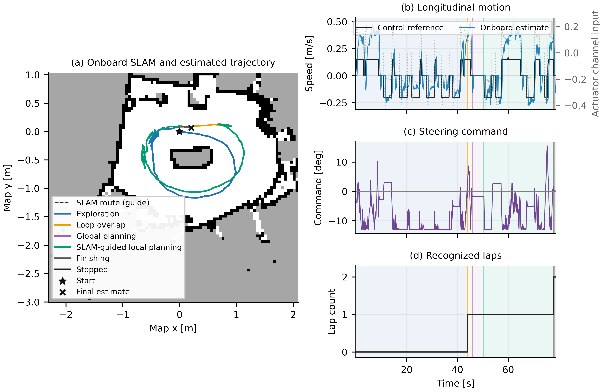
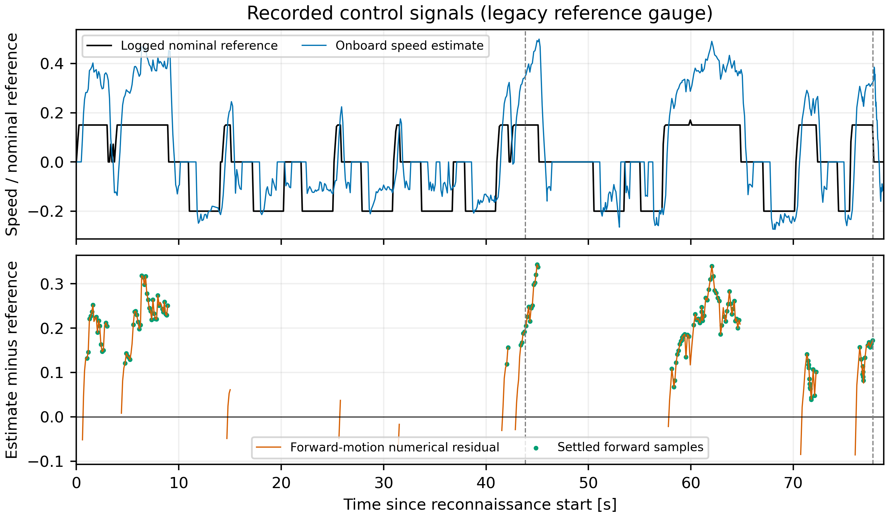

# Physical follow-up and reference tracking — run 20261024_211216

**The operator confirmed two physical laps, an automatic stop and no boundary
contact. Speed-reference tracking is still not validated.** The second lap
included four reverse recoveries. This run does not replace approved acquisition
`20261024_005311` or its sealed source/data snapshot.

The operator replaced/recharged the shared battery and raised the inner boundary
so it could be seen by the LiDAR when approaching the curve. It was not visible
from the initial pose. The trial selected the **approved parameter profile**,
including its original forward/reverse maps and steering behavior. Experimental
forward feedback scaling and steering-confidence gating were neutral. Runtime
source was the recorded `0adee61` branch state, with the added logging fields.

Battery, boundary visibility and parameter selection differ from the failed
initialized trials. This is a development repeat, not an isolated ablation or
proof of a software fix for invisible boundaries.

## Recorded outcome

| Quantity | Reconnaissance lap | Second lap |
| --- | ---: | ---: |
| Duration | 43.842 s | 33.922 s |
| Reverse starts | 6 | 4 |
| Forward-command time | 12.784 s | 13.041 s |
| Reverse-command time | 18.418 s | 9.536 s |
| Zero-command time | 12.640 s | 11.345 s |

On the second lap, reverse plus zero commands occupied **61.56%** of the lap.
Command duration is not physical stop/reverse duration: the motor has engagement
delay and the vehicle can coast. The second lap used **MAP_GUIDED** continuation.
The global candidate was rejected; this is not direct optimized-raceline tracking.



## How close was the controller to its reference?



The actual `v_target` reference is recorded separately from final actuator input
`v_cmd`. The table uses time-weighted values from settled forward samples:
positive reference and command, onboard speed above 0.05 m/s, no recovery over
the preceding approximately 0.8 s, and reference range below 0.025 in that window.
Signals retain their recorded values and timestamps. Nothing is scaled or
time-shifted to make the estimate match the reference.

| Settled forward diagnostic | Lap 1 | Lap 2 |
| --- | ---: | ---: |
| Selected duration | 6.243 s | 9.378 s |
| Logged nominal reference | 0.150 | 0.150 |
| Onboard estimated speed | 0.363 m/s | 0.354 m/s |
| Mean numerical estimate-minus-reference residual | +0.213 | +0.204 |
| Mean absolute numerical residual | 0.213 | 0.204 |
| Root mean squared numerical residual | 0.219 | 0.216 |
| Proportional-feedback saturation fraction | 34.6% | 33.1% |

The estimated speed is **not close to the logged reference**. The reference in
this retained profile uses the original, uncalibrated command convention;
it cannot be interpreted as an independently verified physical speed setpoint.
The residuals above expose the internal mismatch, not absolute physical speed
accuracy. There is no external motion ground truth. Reporting a small physical
tracking error, or rescaling the measured trace to suggest one, is unsupported.

The original forward bridge is `PWM = 15 + 33 * input`. The time-weighted median
forward input on lap 2 was **0.105**, not the nominal reference `0.150` and not a
direct speed measurement. Feedback, inverse shaping and launch explain why
the final input is a different signal from the reference.

## What Kalman did

- Longitudinal confidence ended at **0.0860**, below the required **0.5**.
- The learned longitudinal inverse was **not applied**. Effective gain/offset
  remained **1 / 0**; the raw fit ended at **0.8469 / 0.1716** after 28 updates.
- All recorded positive input time on lap 2 was below the instantaneous
  deadband learning threshold `u_dead + 0.15` (approximately `0.22` here).
  This CSV check is not an exact replay of every filtered command window, but
  it shows why normal forward operation supplies little usable learning data
  in the legacy gauge. The identifier recorded 716 deadband rejections overall.
- Steering parameters were applied in the approved profile, but steering
  consistency confidence was zero: its residual statistic was **14.869**, above
  the configured threshold **3.0**. Physical completion does not establish that
  the full identified model converged.

The retained JSON also includes raw contemporaneous curvature diagnostics.
Curvature divides yaw change by distance and becomes ill-conditioned near zero
motion. Some logged curvature observations are rejected by the identifier's
speed gate; they must not be presented as accepted wheel-angle measurements or
as a validated steering-accuracy metric.

## Timing and power

No live power-fault samples, bridge timeout, core-busy stop or propagated-pose-age
stop was recorded. Maximum driver publication gap was **40.19 ms**. Median/P95
propagated-pose age was **15.00 / 22.97 ms**. Median/P95 hybrid odometry processing
was **14.045 / 18.439 ms**, maximum **24.06 ms**. These measurements do not indicate
sustained ROS congestion as the explanation for the maneuver time.

Three control cycles stopped for an old independent LiDAR correction, and the
maximum estimator interval was **499.66 ms**. These faults are preserved in the
data. Hybrid processing includes preprocessing, ICP/network or stationary hold,
deskew and integration; it is not network inference alone.

## Evidence and reproduction

The complete local acquisition is
`archive/generated/paper/real_vehicle_20261024_211216/`, including raw IMU/LiDAR,
driver inputs, commands, map, resources, runtime source/configuration snapshots,
operator feedback, plots and analyses. All **94 downloaded payload files** match
the Pi's post-stop RAM inventory. Four helper files and two transient pointer/
marker files were outside those downloaded run directories and are listed in
the copy report. No payload was copied before the vehicle stopped. Motor duty
was subsequently verified at **7.5% neutral**, with the container removed.

- [Tracking metrics, masks and source hashes](control_tracking.json)
- [Timing and sensor audit](timing_and_sensor_metrics.json)
- [Forward learning-gate diagnostic](learning_gate_review.json)
- [Operator confirmation](operator_feedback.json)
- [Copy verification](copy_verification.json)
- [Condition changes and source identity](trial_context.json)
- [Tracking figure, vector PDF](control_tracking.pdf)
- [Execution figure, vector PDF](real_vehicle_execution.pdf)

From the repository root:

```bash
simulation/learning/.venv/bin/python real_vehicle/tools/pc/review_control_tracking.py \
  archive/generated/paper/real_vehicle_20261024_211216/raw/diagnostics \
  --output archive/generated/paper/real_vehicle_20261024_211216/control_review
```

The analysis rejects older captures without an actual reference column; it does
not invent reference traces. Its per-lap results reproduced the first export
from the saved CSV. No additional vehicle movement was launched for this review.

Navigation and physical reference tracking remain separate acceptance criteria.
A subsequent speed-calibration experiment should preserve the steering and
recovery behavior of this successful run, validate the forward speed/PWM mapping
and provide forward data above the learning gate. That comparison has not been
performed in this run. Neural weights were unchanged.
