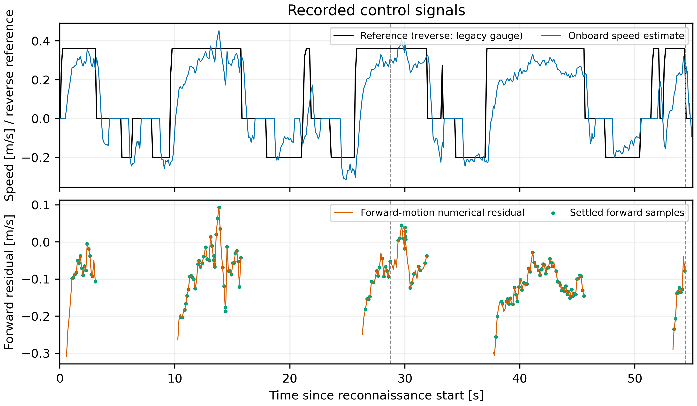
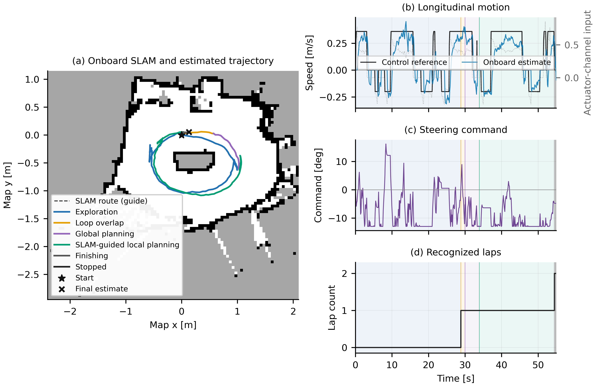

# Longitudinal-only follow-up from run 211216

**Run `20261024_214635` reached its two-lap stop; speed tracking remains short of
the goal.** The operator reported multiple completed physical laps. Exact
physical lap count, boundary contact and a pace assessment were not specified.

This experimental `tracking` profile calibrates the forward bridge using the
latest completed physical run. It preserves the approved steering estimation,
geometry, lane margins, reverse conversion and geometric recovery selection.
The former initialized profile remains available separately.

Six moving-segment medians give a median onboard-speed / previous-input ratio
of 3.811, rounded to **3.8**. The moving intercept is fixed at zero because these
closed-loop observations cannot independently establish both coefficients.
[calibration.json](calibration.json) retains all points, including slow segments,
selection and source hashes. The scatter is large; this is an initialization
for bounded feedback, not precise motor metrology.

Forward conversion is `PWM = 15 + (33 / 3.8) * input`. Actual forward references
are **0.36–0.42 m/s**, chosen near the observed moving pace. Proportional feedback
and its authority use the corresponding command units, with the previously
delay-tested gain 0.17. Launch/deadband command units are converted as well.
No measured velocity is scaled or time-shifted. Kalman starts at unit gain,
zero offset and zero confidence; its acceptance thresholds remain active.
Forward-only identification prevents reverse samples from changing the forward
inverse. Positive-direction overspeed can supply learning data.

Forward PWM remains at most 28.2, reverse at most 31.2. Two laps, 40 m estimated
travel and 300 s remain the finite mission limits. Recording is to RAM; copies
are made after stop. The runner verifies active profile parameters before arm.

```bash
./real_vehicle/tools/pc/race_pi.sh --profile tracking --dry-run run
./real_vehicle/tools/pc/race_pi.sh --profile tracking run
```

## Captured result



| Recorded quantity | Lap 1 | Lap 2 |
| --- | ---: | ---: |
| Recognized duration | 28.724 s | 25.650 s |
| Reverse starts | 4 | 2 |
| Selected forward duration | 8.705 s | 9.309 s |
| Actual forward reference mean | 0.360 m/s | 0.360 m/s |
| Onboard speed mean in selection | 0.284 m/s | 0.256 m/s |
| Estimate-minus-reference bias | -0.076 m/s | -0.104 m/s |
| Mean absolute residual | 0.081 m/s | 0.106 m/s |
| Root mean squared residual | 0.094 m/s | 0.117 m/s |

The selection requires approximately 0.8 s of continuous positive, nearly
constant reference without recovery, positive actuator input, and speed above
0.05 m/s. It does not prove that physical acceleration has fully settled. All
signals retain their actual values and original timestamps. Including all
forward-requested samples, lap 2 MAE is **0.148 m/s**, over 14.410 s; this includes
launches and forward commands while the car is still coasting backward.

The lap 2 selected MAE remains **29.5% of the 0.360 m/s reference**. The moving
onboard speed is lower than in approved-profile run 211216 (0.354 m/s in its
selection), even though lap duration improved. The former legacy-reference
MAE of 0.204 cannot establish a 48% physical-control improvement: the two
reference conventions differ and there is no external ground truth.

Longitudinal confidence rose from 0.086 in run 211216 to **0.279**, but stayed
below **0.5**. The learned inverse was not applied. Its raw gain/offset fit was
0.686 / 0.082 after 33 updates; effective gain/offset stayed 1 / 0. Deadband
rejections numbered 127. Calibration plus bounded proportional feedback still
leaves a static bias when the loaded moving branch differs from the prior;
proportional feedback alone does not guarantee zero steady error. Lowering the
confidence gate just to activate an uncertain two-parameter fit is not justified.

The final status field `recover_count` resets at each recognized crossing. It
was zero after lap 2; **that did not mean no recoveries occurred**. An initial
live interpretation incorrectly said zero reverses. The full event history and
signed command trace establish 4 and 2 starts, corrected above. On lap 2,
reverse and zero commands occupied 5.739 and 5.501 s, respectively. These are
command durations, not measured physical stop durations.

The second lap used **MAP_GUIDED**, with direct global trajectory tracking
rejected. Steering confidence was zero despite the approved steering model
being active. Full model convergence and optimized trajectory tracking remain
unsupported.



## Why it stopped and timing limits

The arm helper exited with **`driver_done`** after the onboard counter reached
two laps. Final motor neutral and container removal were verified. There were
zero live Pi power-fault samples and zero bridge timeouts. These do not measure
motor terminal voltage or rule out load-dependent power loss.

Median/P95 propagated-pose age was **14.80 / 19.83 ms**. Hybrid odometry compute
was **14.57 / 18.70 ms**; scan-stamp-to-output latency was **149.54 / 174.33 ms**.
Maximum driver / bridge publication gaps were **57.83 / 80.20 ms**. One old-LiDAR
correction stop cycle and a maximum estimator interval of **404.21 ms** remain
in the data. Reactive computation P95 was 115.8 ms and control retained previous
commands during 2,214 core-busy holds; there were no core-busy or pose-age stops.
Thus timing is not perfect, even though the final stop was mission completion
and no sustained bridge timeout occurred. This run does not isolate every
contribution of load, estimation error and feedback delay to the speed bias.

## Reproducibility and failed first attempt

The complete local capture is
`archive/generated/paper/real_vehicle_20261024_214635/`, including raw sensors,
source/configuration snapshots, map, resources and figures. All **97 downloaded
payload files** match the Pi's post-stop RAM inventory. The 13-file deployment
was hash-verified before launch; all 33 graded disarmed checks passed. The
311-test suite passed before the selector correction; 27 targeted profile,
SSH and RAM-storage checks passed after that correction. Controller core files
were not changed in this follow-up.

The first attempt, `214318`, lost the requested selection when the canonical
CPU helper changed user through `sudo`, which removed the environment variable.
It started the older initialized profile, moved about 0.894 m estimated and was
externally stopped after 7.78 s armed, without a completed lap. The arm helper's
power-or-stale-log reason coincided with external teardown; the power CSV had
no live fault. All 80 payload files were copied and verified. The operator reset
the car before the corrected run. Selection is now persisted in the per-trial
RAM marker and missing/conflicting requests fail before startup. The canonical
approved helper bytes remain unchanged.

- [Full tracking metrics and original source hashes](control_tracking.json)
- [Timing, sensors and resources](timing_and_sensor_metrics.json)
- [Operator response and its scope](operator_feedback.json)
- [Copy verification](copy_verification.json)
- [Selector failure and fix](selector_failure_review.json)
- [Vector tracking figure](control_tracking.pdf)

This is post-deployment hardware calibration with unchanged odometry weights.
It must not be labeled untouched zero-shot controller transfer. This follow-up
does not validate accurate speed tracking. The approved 005311 acquisition and
successful 211216 evidence are retained unchanged; the default profile is still
`approved`.
