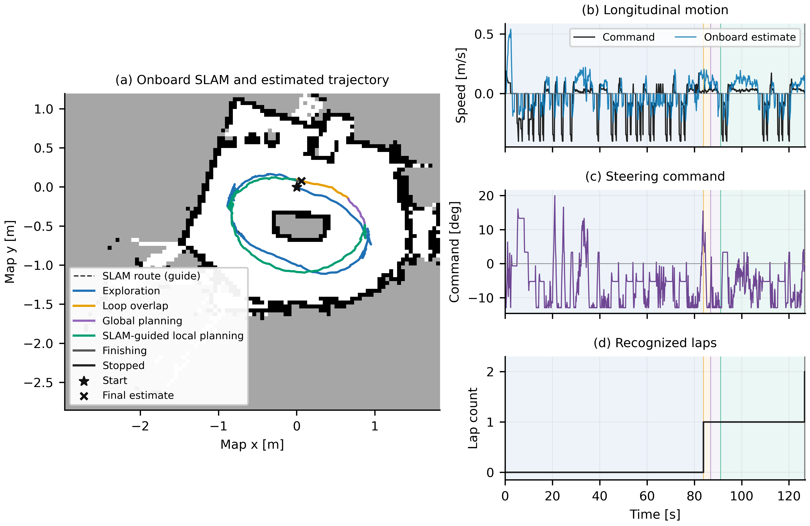

# Approved real-vehicle two-lap capture

This earlier capture remains preserved. The operator subsequently selected
[run 20261024_005311](../20261024_005311/README.md), which restored the desired
speed with a confidence gate on the longitudinal inverse, as the retained
version. Its code/data have a separate snapshot and tag.

ROS run **20261024_000432**, diagnostic **20261024_000431**, October 24, 2026
(operator date, Europe/Paris). The operator confirmed that the car completed
both laps and stopped, and selected this configuration for preservation.

| Recorded interval | Duration | Reverse starts |
|---|---:|---:|
| Reconnaissance | 83.823 s | 13 |
| Second lap, including planning and SLAM guidance | 42.773 s | 4 |

The controller ended with `driver_done` after the second recognized crossing.
The maximum command publication gap was 42.0 ms; no stale-data or core-busy
stop was recorded. The second lap used a SLAM route to guide live-LiDAR local
planning. The optimized global candidate failed curvature/clearance checks;
these data do not demonstrate direct tracking of that rejected candidate.
Map coordinates, speed and trajectories are onboard estimates. Contact with
track boundaries was not reported either way.

## Data and figures

- [Complete portable archive](real_vehicle_20261024_000431.zip), 31,516,045 bytes:
  raw sensors, odometry, control, PWM readback, maps, planning/recovery events,
  power/temperature, process resources, exact source/configuration/weights,
  provenance and offline figure reproduction scripts.
- [Archive SHA256](real_vehicle_20261024_000431.zip.sha256):
  `c0c3a3bae9fcce83ee260d3f27d9a6aab2e56616693a5eda054ee87c3c5b178a`.
- [Main execution figure](figures/real_vehicle_execution.pdf),
  [map and both laps](figures/slam_map_and_laps.pdf),
  [SLAM handover](figures/slam_handover_detail.pdf),
  [within-run lap comparison](figures/single_run_lap_comparison.pdf),
  [odometry and timing](figures/real_odometry_and_timing.pdf),
  [Raspberry resources](figures/raspberry_resources.pdf).
  Every figure also has SVG and 600 dpi PNG output, with English labels.
- [Numeric metrics](paper_metrics.csv), [LaTeX timing table](paper_timing_table.tex),
  [full metric definitions](real_run_metrics.json),
  [command/PWM analysis](motion_effort_metrics.json) and
  [command duration accounting](lap_command_budget.csv).
- [Detailed capture report](CAPTURE_README.md). Its `raw/`, `figures/`,
  `metadata/` and `reproducibility/` paths refer to the extracted portable ZIP.

All 302 payload files, ZIP CRC and every archived entry SHA256 were verified.
The original archive remains byte-identical.
The standalone SVG/CSV presentation copies use normalized whitespace for Git;
the ZIP retains the original exported bytes and checksums. Raw capture contains 15,869 IMU
samples and 1,565 scans; file/schema/count/time checks passed. Six LiDAR header
intervals exceeded 150 ms and are retained, including the longest at 449.47 ms.
The recorder was best effort; complete files do not prove lossless transport.

## Preserved runtime

[The approved runtime manifest](approved_runtime_manifest.json) identifies
138 selected files that matched the PC and Raspberry before and after this
trial. The repository runtime is restored to those contents. Exact launch
helpers are versioned in
[`tools/core/validated_trial_20261024_000432`](../../../tools/core/validated_trial_20261024_000432/README.md).
They retain the original parameters and guards; see
[RAM capture](../../ram_logging.md) and [race-stack setup](../../race_stack.md).
The selected model weights are included in the ZIP. Generated model-output
directories remain outside normal source tracking.

## Scope of the measurements

Hybrid odometry processing median/P95/max was 14.03/18.433/34.63 ms, including
ICP/network or stationary hold, feature construction, deskew and integration.
This is not isolated network inference. Sensor-header age includes LiDAR sweep
acquisition and input waiting. CPU percentages in the resource plot use one
core as 100%; the container averaged 196.66% on a four-core Pi 5 at 2.0 GHz.

Stationary stability and scan consistency require no external ground truth,
but are correlated diagnostics of the deployed hybrid pipeline, not ATE/RPE or
absolute position error. Motor terminal voltage/current was not measured;
clean Pi supply flags cannot establish battery charge or motor power.
The full stack underwent prior engineering adjustments and online adaptation.
Unchanged learned weights do not establish untouched zero-shot evaluation of
the whole autonomy system or statistical reliability on arbitrary tracks.
