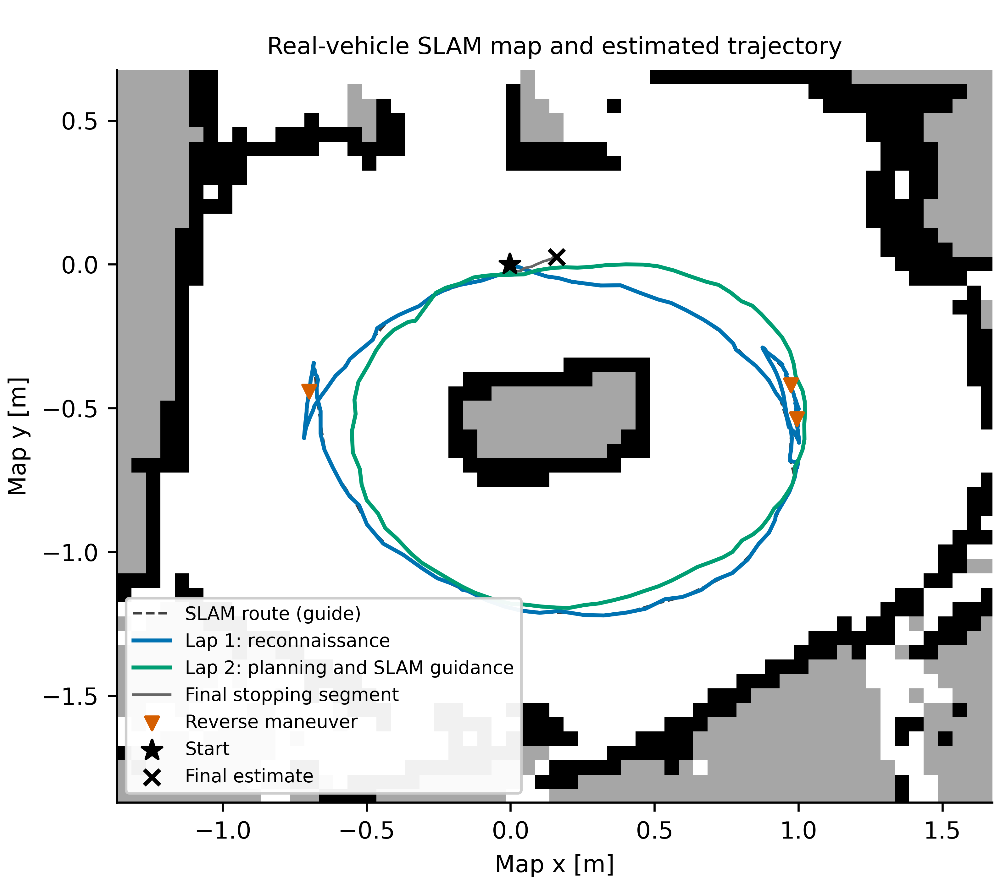

# Accepted calibrated physical run — 20261024_220316

The operator confirmed two physical laps, no boundary contact and **no reverse
on the second lap**, and approved the overall behavior. The car stopped on
`driver_done` after the programmed two-lap count. Motor neutral and container
removal were verified. This is the latest recommended calibrated hardware
profile; the original approved 005311 acquisition remains preserved separately.


| Recorded quantity | Reconnaissance lap | Second lap |
| --- | ---: | ---: |
| Duration | 29.644 s | 10.875 s |
| Reverse starts | 3 | **0** |
| Forward-command duration | 13.563 s | 10.875 s |
| Reverse-command duration | 8.780 s | **0.000 s** |
| Zero-command duration | 7.301 s | **0.000 s** |
| Selected forward duration | 6.730 s | 9.288 s |
| Actual reference mean in selection | 0.360 m/s | 0.360 m/s |
| Onboard estimated speed mean in selection | 0.337 m/s | 0.309 m/s |
| Mean estimate-minus-reference bias | -0.023 m/s | -0.051 m/s |
| Mean absolute reference residual | 0.064 m/s | **0.054 m/s** |
| Root mean squared reference residual | 0.075 m/s | 0.066 m/s |

The selection requires approximately 0.8 s of positive nearly constant
reference, no recovery in that window, positive actuator input and onboard
speed above 0.05 m/s. It does not establish zero physical acceleration. Over
the **whole second lap**, the onboard mean was 0.308 m/s and MAE was 0.0555 m/s.
The final selected error is about **15.1% of the 0.360 m/s reference**, not zero.
No estimate was rescaled or shifted in time to improve the figure.


Compared descriptively with run 214635 at the same reference and selection,
lap-2 MAE changed from 0.1063 to 0.0542 m/s, an observed reduction of **49.0%**;
reverse starts changed from 2 to 0. This is one development repeat, not an
isolated ablation or statistical success-rate study. Initial placement,
unmeasured battery/load and online steering estimates also differ.

## What changed

Runtime commit **`f907cce`**, profile **`tracking`**, revision
`forward_trim_20261024`, frozen as tag
[`real-car-calibrated-20261024-220316`](https://github.com/Santiago23florido/Deep-Drive-APEX/tree/real-car-calibrated-20261024-220316):

The tag freezes acquisition-time source. When checking out that tag, select
`--profile tracking` explicitly; the PC default was updated after acquisition.

- Forward bridge: `PWM = 15.7 + (33 / 3.8) * input`, a 0.7-point moving-intercept
  trim relative to run 214635. Zero command still requests neutral.
- Forward input cap 1.43 maps to at most 28.118 PWM, below the existing 28.2
  ceiling. Reverse conversion and its 31.2 ceiling remain unchanged.
- Forward turn-smoothing penalty `w_smooth` changed from 0.10 to 0.05.
- Actual forward references remain 0.36–0.42 m/s. No controller core, neural
  weights, servo endpoints, footprint, lane clearance or recovery-disable
  change was made. The same 2-lap / 40 m estimated / 300 s bounds remain.

The entry replay and its limitations are in the
[refinement report](../../calibration/speed_initialization_20261024/tracking_refinement/README.md).
These settings apply to general sensed geometry; they contain no oval-specific
turn schedule or fixed reverse direction.

## Kalman identification: active, not fully converged

The longitudinal identifier accepted **12 updates**, fewer than the existing
minimum **20**. Reported longitudinal confidence therefore remained **0.0**;
the inverse also requires confidence at least **0.5** and consistent residuals.
The raw gain/offset estimate was **0.8039 / 0.0782**, with residual statistic
1.230. It was **not applied**: effective gain/offset remained **1 / 0**.

The observed speed improvement came from the calibrated feedforward and
bounded feedback, together with the changed trajectory. It is not evidence
of longitudinal Kalman convergence. The shorter successful mission supplies
less accepted identification data; a lower final confidence than the prior
trial does not establish a filter crash or justify lowering the acceptance gate.

Lever confidence was 0.965. Steering consistency confidence was zero because
its residual statistic, 13.998, exceeded the configured threshold 3.0, even
though the approved steering adaptation remained active. Thus **full plant
model convergence is not demonstrated**. Do not use this run to claim it.

## SLAM and the absence of a second-lap reverse

Mapping ran during reconnaissance. The second lap continued from the current
pose through asynchronous global planning and **MAP_GUIDED** local execution.
The global candidate was rejected for clearance and curvature: maximum
curvature 2.376 versus allowed 1.467 per metre. Its drawn path must not be
presented as an executed optimized raceline.

The live planner instead selected footprint-checked forward arcs using the
observed map route and current LiDAR. The full event history and signed command
trace record zero lap-2 reverses, matching the operator. Reverse recovery stays
available for other starts or tracks; this single run does not prove it is
unnecessary in every geometry. Final `recover_count` resets at a crossing and
is not a cumulative maneuver count.



## Timing, sensors and Raspberry Pi

| Recorded quantity | Value | Scope |
| --- | ---: | --- |
| Raw IMU / LiDAR messages | 7,148 / 709 | Complete copied files; best-effort capture |
| Hybrid processing median / P95 / max | 15.330 / 19.796 / 27.650 ms | Preprocessing, ICP/network or hold, deskew, integration |
| Scan stamp to output median / P95 | 150.425 / 162.979 ms | Includes sensor acquisition and waiting |
| Propagated pose age median / P95 | 14.900 / 22.300 ms | Pose read by the controller |
| Maximum driver / bridge command gap | 40.30 / 68.11 ms | Zero bridge timeout samples |
| Old independent-LiDAR stop cycles | 0 | Longer sensor intervals remain in raw data |
| Maximum estimator interval | 253.69 ms | Three intervals above 150 ms |
| Reactive computation median / P95 | 94.7 / 118.5 ms | Scan callback planning cost |
| Core-busy command holds / stops | 1,694 / 0 | Previous command retained while core was busy |
| Live Pi power-fault samples | 0 | No motor terminal voltage/current measurement |
| Maximum Pi temperature | 70.8 °C | Temporary 2.0 GHz CPU ceiling |
| Stationary maximum estimated excursion | 1.350 mm over 9.680 s | Full pipeline, stationary hold active |

The data do not show a power-triggered final stop. Timing remains imperfect:
reactive P95 exceeds one nominal 100 ms scan period. Pose propagation and
continued command publication do not constitute new independent LiDAR updates.
Static hold and scan consistency are correlated pipeline diagnostics, not
external odometry accuracy, ATE/RPE or isolated neural inference results.

## Evidence, exact source and reproduction

- [Complete capture/source/model ZIP](real_vehicle_20261024_220316.zip) and
  [SHA256](real_vehicle_20261024_220316.zip.sha256).
- [Runtime source/configuration/model manifest](runtime_manifest.json):
  **144 selected files matched PC/Pi after stop**, including the unchanged
  PT/ONNX checkpoints. The 13 modified deployment files were also verified
  before launch. The archive includes their exact bytes.
- [Post-stop raw copy verification](copy_verification.json): **97 downloaded
  payload files** matched the Pi's RAM inventory. Helper/pointer files outside
  those directories are explicitly listed. Recording used RAM and durable
  copying occurred after neutral.
- [Operator confirmation](operator_feedback.json),
  [comparison scope](comparison.json), [trial context](trial_context.json).
- [Tracking metrics and selections](metrics/control_tracking.json),
  [timing, resources and sensor metrics](metrics/real_run_metrics.json).
- [Tracking PDF](figures/control_tracking.pdf),
  [execution PDF](figures/real_vehicle_execution.pdf),
  [SLAM transition PDF](figures/slam_handover_detail.pdf),
  [odometry/timing PDF](figures/real_odometry_and_timing.pdf),
  [resources PDF](figures/raspberry_resources.pdf),
  [lap comparison PDF](figures/single_run_lap_comparison.pdf).

All figure labels and captions are in English. The portable archive contains
raw data, analyses, source, checkpoints, package versions, a payload manifest,
`verify_archive.py` and `reproduce_figures.py`. Reproduction uses NumPy, SciPy,
Matplotlib and PyYAML and does not connect to the car. The complete local copy
is `archive/generated/paper/real_vehicle_20261024_220316/`.

312 real/telemetry/PC tests passed before the trial. The PC default-profile
update passed its 11 SSH-boundary tests afterward. The driving core remains
shared with the simulator; this physical result does not replace the pending
final Gazebo campaign, repeated trials or simulator-truth odometry evaluation.

The PC entry point now selects this accepted calibrated profile by default:

```bash
./real_vehicle/tools/pc/race_pi.sh preflight
./real_vehicle/tools/pc/race_pi.sh run
# Explicit selection, or the retained historical profile:
./real_vehicle/tools/pc/race_pi.sh --profile tracking run
./real_vehicle/tools/pc/race_pi.sh --profile approved run
```

`run` moves the vehicle after checks pass. It requires a stationary vehicle at
the start and a clear track. Use `--dry-run` to preview without connecting.

This accepted **calibrated follow-up** has fixed odometry weights and disclosed
hardware tuning. It is not untouched zero-shot transfer of the complete
controller stack, proof of absolute real-world speed accuracy, or evidence of
Kalman convergence. The sealed original approved 005311 data/tag remain intact.
