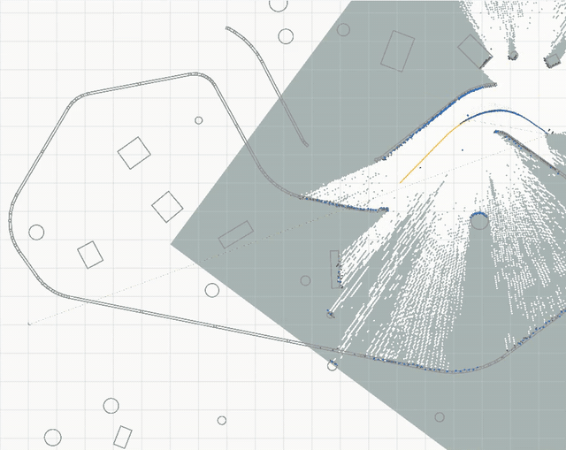
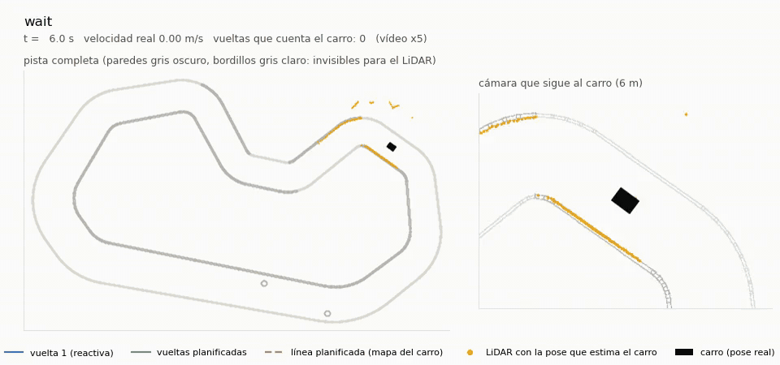
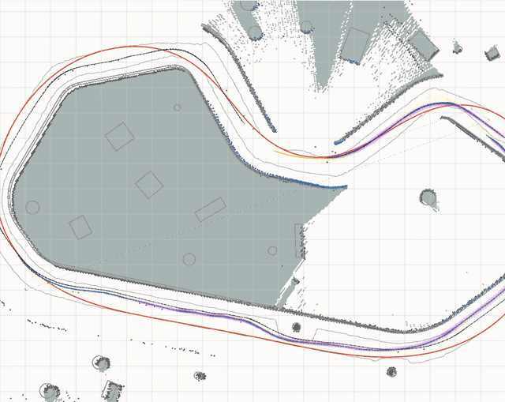

# Simulation

This directory is the active development environment when the physical car is unavailable. It contains the Gazebo model and worlds, simulation-specific ROS packages, RViz layouts, tools, run data, and the earlier simulator kept for reference.

## October 24, 2026 integration status

The [latest accepted calibrated physical run `220316`](../real_vehicle/docs/paper/20261024_220316/README.md)
completed two operator-confirmed laps without contact and with 3 / **0** reverse
starts. The selected lap-2 onboard speed MAE was **0.054 m/s** at a 0.360 m/s
reference. Neural weights and shared controller core were unchanged; the
forward hardware trim and turn-smoothing configuration are recorded. The
longitudinal inverse remained inactive after 12 updates, below the minimum 20.
This physical result is not a completed final-profile Gazebo evaluation or
evidence of full model convergence. The PC hardware launcher now defaults to
this `tracking` profile; simulator actuator maps still require their own setup.

The simulator includes the final shared driving-core corrections used by
[approved physical run `20261024_005311`](../real_vehicle/docs/paper/20261024_005311/README.md):
confidence-gated longitudinal inversion, asymmetric steering authority,
geometry-based reverse recovery, mission/lap guards and continuous map-guided
handover. The learned estimator also holds its IMU-predicted pose while parked,
preventing fictitious travel between stationary scan corrections. No controller
runtime or neural weights were changed during the documentation integration.

| Evidence | Available result | Scope |
| --- | --- | --- |
| Approved physical laps | 46.837 / 14.594 s; 8 / 1 reverse starts | Development track, MAP_GUIDED continuation |
| Final shared core | Byte/semantic parity tests against the real package | Hardware I/O and parameter profiles remain distinct |
| Historical Gazebo runs below | Reactive mapping followed by planned laps | Results belong to their recorded earlier versions |
| Final-version Gazebo campaign | Still required | Multi-track trials, baselines and ablations |

See the [preprint readiness report](../docs/reports/preprint_readiness_20261024.md)
for the remaining experiments and publication artifacts. The real archive
includes six English figures and the exact PT/ONNX weights; broader training
outputs and generated simulation runs remain Git-ignored.

The subsequent [forward speed calibration experiment](../real_vehicle/docs/calibration/speed_initialization_20261024/README.md)
uses the same control law and unchanged odometry weights. All 204 research
regression tests pass. A two-dimensional replica trial completed two laps, a
second seed failed, and full Gazebo timed out after localization drift prevented
the second recognized lap. These are development outcomes, not a completed
final-version campaign or a new approved physical result.

Additional opt-in shared-core switches convert forward feedback units and gate
uncertain steering inversion; the approved profile keeps their neutral defaults.
The [follow-up report](../real_vehicle/docs/calibration/speed_initialization_20261024/physical_trial_211216/README.md)
records successful physical navigation with the approved profile and changed
battery/boundary conditions, together with the unresolved speed-reference error.
It does not validate the experimental initialized profile or replace the
remaining simulation campaign.

The later [`tracking` hardware follow-up](../real_vehicle/docs/calibration/speed_initialization_20261024/tracking_followup/README.md)
calibrates only the forward profile from run 211216 and retains approved
steering/recovery behavior. Its captured two-lap mission ended normally, but
selected lap-2 speed MAE was 0.106 m/s and the longitudinal inverse remained
inactive. This follow-up changes no shared controller core or neural weights;
its six motor-delay checks are not a completed Gazebo campaign. The calibrated
hardware profile still requires final simulator integration and controlled
repeat trials before a speed-tracking claim.

## Run recognition, mapping and planned continuation

From the repository root:

```bash
source /opt/ros/jazzy/setup.bash
cd simulation/ros2_ws
colcon build --symlink-install --packages-select rc_sim_description apex_fusion_research
source install/setup.bash
cd ../..
./simulation/tools/sim/apex_real2sim_up.sh \
  --track test_unseen --seed 6 --laps 3 --no-rviz
```

Prepare the v7e checkpoint first using the
[learning README](learning/lidar_imu_pose/README.md). The driver consumes its own
estimated pose and noisy sensors; the separate referee uses simulator truth for
evaluation. No physical-car connection is used by this launcher.

## Autonomous Racing on a Track It Has Never Seen (Simulation)

This section presents historical demonstrations. Their figures and seed tables
are retained with their original experimental context; they are not new results
from the final October 24 controller.

<p align="center">
  
</p>

In Gazebo, on a track and with sensor draws never seen in training, the car:

- **Lap 1 (no map):** drives reactively on the LiDAR, following the walls, while `slam_toolbox` builds the map.
- **Closes its own lap:** it detects the crossing of its own start line.
- **Plans a racing line on its own map:** a minimum-curvature line in 0.5 s.
- **Races it:** laps 2 and 3 take about 22 s, against about 48 s for lap 1.

Its only pose is the neural LiDAR-inertial odometry corrected by the SLAM, and it uses only noisy sensors. It knows nothing about the track: it cannot see the curbs, which sit below the LiDAR plane.

| Lap 1: the map grows as the car explores (RViz) | Lap 1 from the logs: LiDAR placed with the car's own pose estimate |
| --- | --- |
|  |  |
| **Laps 2-3 on the planned line (RViz)** | **The car in Gazebo, followed by a camera** |
|  |  |

The full description is in [Real2sim race mode](ros2_ws/src/apex_fusion_research/README.md#131-race-mode-explore-map-race): validation on 4 seeds, the odometry model's training figures, and what worked.

## General simulator quick start

```bash
cd ~/AiAtonomousRc/simulation/ros2_ws
source /opt/ros/jazzy/setup.bash
colcon build --symlink-install \
  --packages-select rc_sim_description apex_telemetry voiture_system
source install/setup.bash
cd ~/AiAtonomousRc
./simulation/tools/sim/apex_sim_up.sh --scenario baseline --rviz
```

## Main Areas

| Path | Purpose |
| --- | --- |
| `ros2_ws/src/rc_sim_description/` | Gazebo model, worlds, bridges, ground truth, and launch files. |
| `ros2_ws/src/apex_telemetry/` | Simulation copy of the APEX pipeline. |
| `ros2_ws/src/voiture_system/` | Simulation compatibility for the vehicle stack. |
| `ros2_ws/src/apex_fusion_research/` | LiDAR/IMU error models, strapdown INS and evaluation for sensor-fusion research ([README](ros2_ws/src/apex_fusion_research/README.md)). |
| `tools/sim/` | Startup, mapping, recording, and controller wrappers. |
| `tools/analysis/` | Offline analysis. |
| `tools/generate_pose_dataset.py`, `tools/pose_dataset/` | Headless multi-scenario LiDAR–IMU pose dataset generator (SQLite + PyTorch loader) ([README](tools/pose_dataset/README.md)). |
| `tools/sim/apex_real2sim_up.sh` | Real2sim closed loop: Gazebo-native sensors made real (A2M8 + LSM6DS3), learned LiDAR-inertial odometry + slam_toolbox driving a dataset format ([README](ros2_ws/src/apex_fusion_research/README.md#13-real2sim-gazebo-native-sensors-and-the-learned-odometry-in-closed-loop)). |
| `learning/lidar_imu_pose/` | Learned LiDAR-inertial odometry: training, evaluation and the live node ([README](learning/lidar_imu_pose/README.md)). |
| `data/` | Simulation runs and generated results. |
| `legacy/Simulateur/` | Earlier simulator; not the recommended workflow. |

Build this workspace independently from `../real_vehicle/ros2_ws` to avoid package-name collisions.

See [Simulation with Gazebo](../docs/08_simulation_gazebo.md) for the full workflow.
